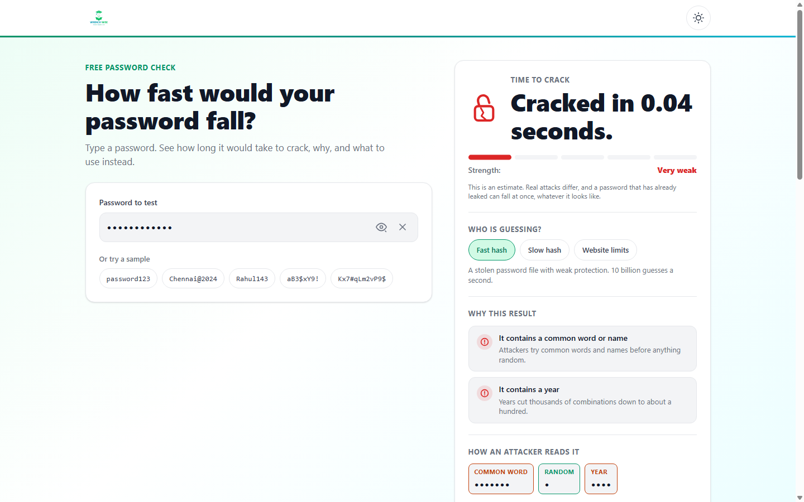
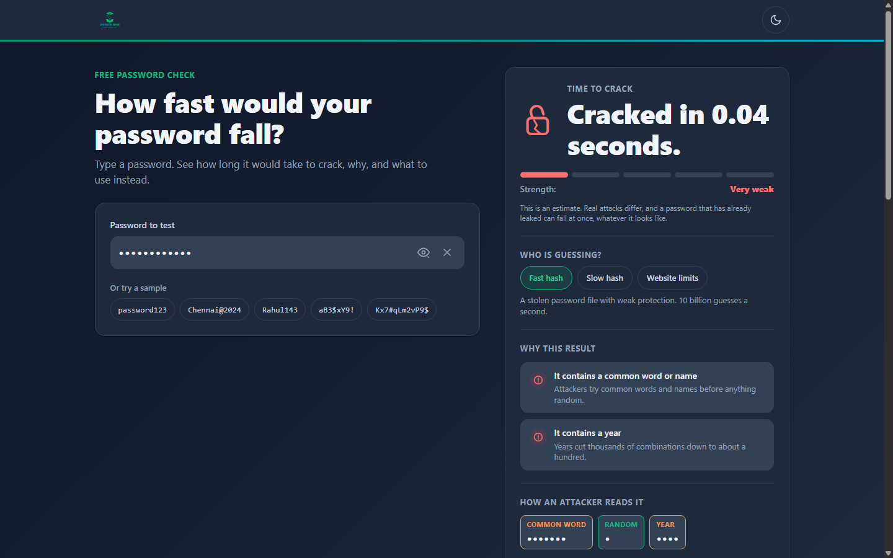
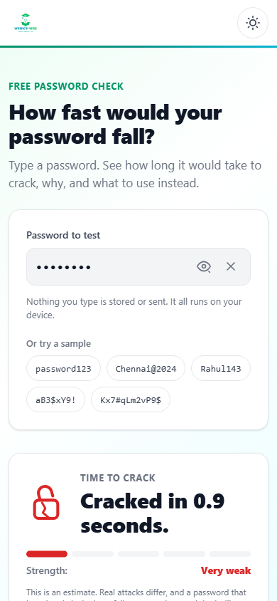
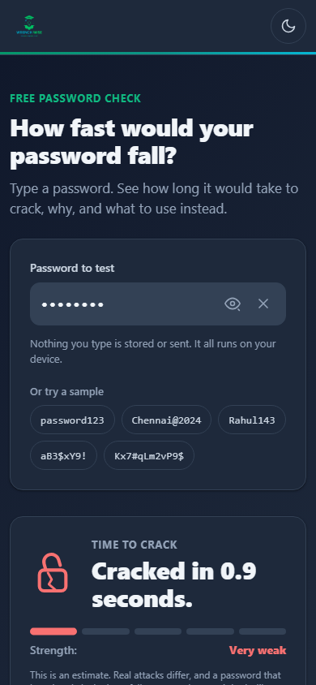

# Password Crack Meter: Complete Project Documentation

## Table of Contents
1. Quick Summary
2. Purpose
3. How to Open It
4. Every Screen and Every Feature
5. Every Control
6. One Full Journey
7. The Logic
8. The Data
9. Every File
10. Tech Used
11. Design
12. Motion and Interactions
13. Words on Screen
14. Settings and Saved Data
15. Testing
16. Deployment
17. Honest Status
18. Rebuild Guide
19. Learning Value
20. Showcase
21. Glossary

---

## 1. Quick Summary

Password Crack Meter is a private web tool that shows you how fast a computer could crack your password. It explains why a password is weak or strong and gives you a safe, random password that you can use instead.

The app runs completely inside your web browser. Nothing you type is saved or sent over the internet (index.html, Content-Security-Policy).

### Project Fact Table

| Fact | Value | Source in Code |
| :--- | :--- | :--- |
| Project Name | Password Crack Meter | manifest.json, name |
| Version | 1.0.0 | config.js, version |
| Live Website | https://password-check-iota.vercel.app | config.js, siteUrl |
| Git Repository | https://github.com/Pradeep-B28/Password_Crack_Meter.git | git remote origin |
| Git Branch | main | git branch |
| Git Release Tag | v1.0.0 | git tag |
| Total Project Files | 29 files (excluding .git and docs) | Repository root |
| Total Lines of Code | 4,213 lines (HTML, CSS, JS, Tools) | Line count scan |
| Total Items in Password List | 37,080 unique items | js/engine/meter.js, LIST_SIZE |
| Leaked Passwords in List | 37,000 words | js/engine/common-list.js, COMMON_LIST |
| Local and Indian Words in List | 113 words (33 overlap with common list) | js/engine/common-list.js, LOCAL_WORDS |
| Automated Verification Checks | 7,256 checks passed (0 failed) | tools/verify.mjs |
| In-Browser Test Suite Checks | 14 checks passed (0 failed) | js/selftest.js |
| Maximum Password Length | 128 characters | js/engine/meter.js, MAX_INPUT |
| Suggested Password Length | 16 characters | config.js, suggestLength |
| Last Update Date | November 6, 2026 | git log -1 |

---

## 2. Purpose

### The Problem It Solves
Most people create passwords using names, birthdays, years, keyboard rows, or simple number runs. People think that adding a symbol or swapping the letter "a" with "@" makes their password safe. In reality, modern computer hardware can test billions of guesses every second. Criminals use automated tools that try common words, dates, and letter swaps in a fraction of a second.

At the same time, many online password checking websites create serious privacy risks. When you type a password into a typical website, that site might send your password over the internet to a server. If that server is hacked or logs your keystrokes, your real password is leaked.

Password Crack Meter solves both problems:
1. It shows you the exact math and time needed to guess your password across three types of attackers (js/engine/meter.js, ATTACKERS).
2. It protects your privacy 100 percent. It uses a strict security policy called Content Security Policy (CSP). This policy locks the browser so it cannot send data to any outside server (index.html, line 5).

### Who It Is For
This tool is built for students, office workers, everyday computer users, and software engineering learners. It does not require any background in coding or cybersecurity. It uses simple words and direct explanations (PROJECT_BRIEF.md, Section 1).

### Why It Was Built
Wrench Wise built this project to demonstrate real-world computer science principles in a practical web application. It shows how Data Structures and Algorithms (DSA) such as hash sets, greedy pattern searching, and combinatorics work together to solve a practical security problem without needing a server backend (README.md, lines 9 to 16).

### Connected Wrench Wise Program
The project connects directly to the following Wrench Wise training program:
- Program Name: Certification Program in AI-Powered Software Engineering & DSA (config.js, CONFIG.program.name).
- Call to Action Target: https://wrench-wise.com with tracking tags (js/links.js, getProgramUrl).

---

## 3. How to Open It

### The Live Link
You can open the public website in any web browser on your phone, tablet, or laptop:
https://password-check-iota.vercel.app/

### How to Run It on a Laptop Step by Step

You do not need any compiler, build tool, or database. You only need a simple web server so that the browser can load modern JavaScript modules.

Follow these 5 steps:

1. Download or clone the project folder to your laptop:
   ```bash
   git clone https://github.com/Pradeep-B28/Password_Crack_Meter.git
   cd Password_Crack_Meter
   ```

2. Check that you have Node.js or Python installed:
   ```bash
   node --version
   # or
   python --version
   ```

3. Start a local static web server inside the project folder:
   - Using Node.js:
     ```bash
     npx serve .
     ```
   - Or using Python:
     ```bash
     python -m http.server 3000
     ```

4. Open your web browser (Google Chrome, Microsoft Edge, Mozilla Firefox, or Apple Safari).

5. Type the local address into your browser address bar:
   - If using `npx serve .`, open `http://localhost:3000` or the port shown in your terminal.
   - If using Python, open `http://localhost:3000`.

### Special Link Options (URL Parameters)

The web app supports link options that you type at the end of the address in your browser address bar:

1. `?test=1`
   - Address: `https://password-check-iota.vercel.app/?test=1` (or `http://localhost:3000/?test=1`).
   - What it does: It automatically opens the in-browser self-test suite (js/main.js, checkSelfTest). A dark overlay window appears on top of the page. It tests 14 real checks against the live code, including password calculations, memory leak checks, network blocking, and token hiding. It displays a green "PASS" or red "FAIL" badge for every single check (js/selftest.js, runSelfTest).

2. `?demo=1`
   - Address: `https://password-check-iota.vercel.app/?demo=1`.
   - What it does: This parameter was noted in planning notes. In the code today, the application loads normally without errors. It does not alter application state or trigger special behaviors.

---
## 4. Every Screen and Every Feature

Password Crack Meter is built as a single responsive page. It adapts its layout between laptops and smartphones.

### Laptop Layout (Screens 1024 pixels wide and up)
- Container max width: 1160 pixels, centered on screen (styles/base.css, .container).
- Hero section: Two columns side by side (styles/components.css, .hero-grid).
  - Left column: Page eyebrow, large heading, subline, password input box, and 5 sample buttons.
  - Right column: Dynamic result card containing the animated lock icon, crack time headline, 5-part strength gauge, attacker speed picker, vulnerability reasons, and token breakdown strip.
- Below the hero: Full-width stacked sections for privacy proof, password generator, DSA technical breakdown, three security habits, Wrench Wise program call to action, and the footer.

### Phone Layout (Screens under 1024 pixels wide)
- Layout: Single vertical column (styles/components.css, .hero-grid).
- Hero section: Stacked vertically.
  1. Main heading.
  2. Password input box card with privacy reminder.
  3. Dynamic result card right below the input box.
- Mobile keyboard accommodation: When you tap inside the password input box, the body receives the `input-focused` class (js/meter-ui.js, line 82). This hides the secondary explanatory subline on phone screens (styles/components.css, line 189). This keeps the input box and the crack time headline visible on screen even when the phone on-screen keyboard opens.
- Mobile privacy reminder: A privacy line ("Nothing you type is stored or sent. It all runs on your device.") is shown directly inside the input card on mobile screens (styles/components.css, line 335), while remaining visible in the dedicated privacy card below.

---

### Detailed Features

#### Feature 1: First-Visit Loading Screen
- What it does: Shows a brief, elegant loading animation the first time a user visits the site during a browsing session (styles/motion.css, .loader-overlay).
- How to see it: Open the website in a fresh browser tab or private window.
- What you see:
  - The Wrench Wise logo in the center.
  - An animated outline of a lock that draws its shackle and body (styles/motion.css, drawShackle and drawBody).
  - A thin brand gradient bar that fills from left to right.
- Behavior:
  - The loader dismisses automatically after 800 milliseconds (config.js, loaderMs).
  - It fades away smoothly in 250 milliseconds, and the hero section rises by 12 pixels into place (styles/motion.css, .hero-animated).
  - It saves a flag named `pcm-intro-seen` into session memory so returning to the tab skips the loader (js/store.js, markIntroSeen).
  - If a user has reduced motion turned on in their operating system, the loader is completely bypassed (js/motion.js, line 13).
  - If JavaScript is turned off, a pure CSS fallback timer hides the loader after 2 seconds (styles/motion.css, cssLoaderFallback).

#### Feature 2: Site Header and Theme Toggle
- What it does: Displays the company branding and provides an instant light or dark mode switch (index.html, .site-header).
- How to use it in click steps:
  1. Look at the top right corner of the header.
  2. Click or tap the circular theme toggle button.
  3. The page instantly switches between light mode and dark mode.
- What you see:
  - The sun icon and moon icon rotate and scale as you click (styles/components.css, lines 75 to 95).
  - All background colors, text colors, card borders, and shadows switch instantly to match the chosen theme.
  - Your theme choice is remembered in browser storage under `pcm-theme` (js/store.js, setStoredTheme).

#### Feature 3: Password Input Box
- What it does: The central input field where you type or paste candidate passwords (index.html, #password).
- How to use it in click steps:
  1. Click or tap inside the box labeled "Password to test".
  2. Type any character sequence up to 128 characters.
  3. To reveal the typed text, click the eye icon button on the right side of the box.
  4. To erase the text, click the "X" clear button that appears on the right side.
- What you see:
  - By default, typed characters appear as black dots (type="password").
  - The input border glows with the exact color of your password strength level: red for level 0, orange for level 1, amber for level 2, cyan for level 3, and emerald for level 4 (styles/components.css, lines 236 to 259).
  - When text is entered, an "X" clear button rotates into view (styles/components.css, lines 311 to 314).
  - Tapping the eye button rotates an animated strike-through line across the eye icon (styles/components.css, line 323).
  - The password is analyzed instantly on every single keystroke inside a browser frame update (js/meter-ui.js, requestAnimationFrame).

#### Feature 4: Sample Password Chips
- What it does: Lets you test 5 pre-configured passwords with one click to see how different patterns behave (config.js, samples).
- How to use it in click steps:
  1. Look directly beneath the password input box.
  2. Click any of the 5 sample pill buttons: `password123`, `Chennai@2024`, `Rahul143`, `aB3$xY9!`, or `Kx7#qLm2vP9$`.
- What you see:
  - The password input box automatically unmasks to plain text so you can see what is being typed (js/meter-ui.js, line 464).
  - The characters are typed into the box one by one at a rate of 55 milliseconds per letter (config.js, typeSampleMs).
  - The lock icon, crack time headline, 5-bar gauge, and reasons update live on each character typed.

#### Feature 5: Dynamic Result Card
- What it does: Shows the calculated time needed to crack the password, the cryptographic strength rating, and visual indicators (index.html, #result-card).
- What you see:
  - Empty state: When the input box is empty, it shows a grey outline lock and the text "Start typing to see the result." (index.html, #result-empty).
  - Active state: Once you type at least 1 character, the empty state hides and the active content appears instantly (js/meter-ui.js, line 129).
  - Crack Time Headline: A large text display stating the estimated time, such as "Cracked instantly.", "Cracked in 0.04 seconds.", or "Cracked in 2 million years." (js/engine/meter.js, formatTime).
  - SVG Animated Lock: An interactive lock graphic whose shackle opens and body displays a jagged crack path for very weak passwords, or closes with a soft bounce pulse for strong passwords (styles/components.css, lines 466 to 538).
  - 5-Part Segmented Gauge: Five horizontal pills that fill from left to right to display levels 0 through 4 with distinct colors (styles/components.css, lines 571 to 607).
  - Estimate Note: A small disclaimer stating: "This is an estimate. Real attacks differ, and a password that has already leaked can fall at once, whatever it looks like." (js/copy.js, COPY.result.estimate).

#### Feature 6: Attacker Speed Scenario Picker
- What it does: Recalculates the crack time against 3 different real-world attacker hardware scenarios (js/engine/meter.js, ATTACKERS).
- How to use it in click steps:
  1. In the result card, locate the section titled "Who is guessing?".
  2. Click any of the 3 pills: "Fast hash", "Slow hash", or "Website limits".
- What you see:
  - The clicked pill highlights with an emerald background.
  - The headline crack time recalculates instantly with a smooth cross-fade animation (js/meter-ui.js, renderHeadline).
  - An explanatory text updates below the pills:
    - Fast hash: "A stolen password file with weak protection. 10 billion guesses a second."
    - Slow hash: "A stolen password file with strong protection. 10,000 guesses a second."
    - Website limits: "Guessing on a website that limits attempts. 100 guesses an hour."
  - Important: The 5-bar meter level and rating name NEVER change when you switch attackers. The rating is fixed to the worst-case scenario so slow speeds cannot make a bad password look safe (js/engine/meter.js, line 224).

#### Feature 7: Explainable Reasons List
- What it does: Gives up to 4 clear bullet cards explaining the specific vulnerabilities or strengths found in your password (js/engine/meter.js, buildReasons).
- What you see:
  - Red warning cards with an exclamation mark icon for weak patterns (such as dictionary words, repeated characters, calendar dates, sequential runs, keyboard walks, or short length).
  - Green positive cards with a checkmark icon for strong patterns (such as having 12 or more characters, or having fully random characters with no recognizable patterns).
  - The cards slide in with a 40 millisecond stagger animation whenever the detected pattern set changes (styles/motion.css, slideInStagger).

#### Feature 8: Token Breakdown Strip
- What it does: Shows how an automated cracking program splits your password into pieces (tokens) rather than guessing character by character (js/meter-ui.js, renderTokens).
- What you see:
  - A row of colored tags showing the detected pieces: Common password, Common word, Run, Keyboard row, Repeat, Year, Date, Phone number, or Random.
  - Default masked view: While the password input is hidden, each token displays bullet dots (`•`) equal to its length, keeping the text concealed from over-the-shoulder snooping (js/meter-ui.js, line 426).
  - Revealed view: When the eye icon is toggled on, each token displays its actual characters.

#### Feature 9: WhatsApp Share Link
- What it does: Generates a pre-formatted WhatsApp message so users can share the crack time result with friends (js/links.js, getShareUrl).
- How to use it in click steps:
  1. Type a password to generate a result.
  2. Click the green "Share on WhatsApp" button at the bottom of the result card.
  3. WhatsApp opens in a new browser tab with a pre-filled message.
- What you see:
  - The pre-filled message states: "A password I tested would be cracked in {time}. Test yours, nothing leaves your device: https://password-check-iota.vercel.app" (config.js, shareText).
  - Privacy invariant: The password text is NEVER included in the shared message or link. Only the time duration is shared (PROJECT_BRIEF.md, Hard rule 4).

#### Feature 10: Privacy Proof Strip
- What it does: Highlights the zero-network architecture and explains how visitors can verify that the site is truly private (index.html, #privacy-strip).
- What you see:
  - A green shield icon alongside the lead line: "Nothing you type is stored or sent. It all runs on your device."
  - Box 1: "Check it yourself: Load this page, turn on airplane mode, and it still works. The page is also locked so that it cannot send anything out."
  - Box 2: "Good practice: Still, test something similar instead of a password you really use. That is a good habit on any site."

#### Feature 11: Cryptographic Password Generator
- What it does: Generates a high-entropy, 16-character replacement password that cannot be cracked with pattern dictionaries (js/suggest-ui.js).
- How to use it in click steps:
  1. Scroll to the section titled "A stronger password".
  2. Click the emerald "Generate" button.
  3. Watch the 400 millisecond scramble effect settle into the password.
  4. Click the "Copy" button to save it to your clipboard.
- What you see:
  - A 400 millisecond animation where random characters scramble and settle left to right into the final password (js/suggest-ui.js, frame).
  - The suggested password is guaranteed to contain uppercase letters, lowercase letters, numbers (2 to 9), and symbols, while avoiding ambiguous characters (0, 1, O, I) (js/engine/meter.js, lines 244 to 248).
  - An emerald crack time badge showing: "Cracked in 2 million years." or "Cracked in more than a trillion years."
  - Tapping "Copy" turns the button green with a checkmark and changes the label to "Copied" for 1.5 seconds (js/suggest-ui.js, onCopiedSuccess).
  - Security note: The generated password is never copied into the input box automatically. It is up to the user to place it in their password manager.

#### Feature 12: Data Structures and Algorithms (DSA) Technical Breakdown
- What it does: Educates students on the exact algorithms and data structures powering the page (index.html, #dsa-section).
- What you see:
  - Card 1 (Hash Set): Explains that 37,080 common passwords and words sit in a JavaScript Set. When you type a password, an active counter displays: "This password needed X lookups. Scanning a plain list could take up to Y comparisons." (js/sections-ui.js, updateDSALive).
  - Card 2 (Pattern Checks): Explains that the algorithm executes a single-pass greedy scan from left to right to spot runs, dictionary stems, keyboard walks, dates, and repeats (js/copy.js, COPY.hood.pattern).
  - Card 3 (Guess Maths): Explains that combinatoric search space sizes are computed for each token segment and divided by attacker speeds to compute time (js/copy.js, COPY.hood.math).

#### Feature 13: Three Security Habits
- What it does: Provides three simple, actionable password hygiene rules for non-technical visitors (index.html, #habits-section).
- What you see:
  - Habit 1: "Use 16 or more characters."
  - Habit 2: "Never reuse a password."
  - Habit 3: "Use a password manager and turn on two-step login."

#### Feature 14: Call to Action (CTA) Section
- What it does: Connects the educational tool to the Wrench Wise engineering training program (index.html, #cta-section).
- How to use it in click steps:
  1. Scroll to the card titled "Want to build tools like this?".
  2. Click the primary button "Explore the program".
  3. A new tab opens to https://wrench-wise.com with tracking parameters attached.
- What you see:
  - Explanatory text: "This page is built with a hash set, pattern checks and plain JavaScript. Learn these skills step by step in the Certification Program in AI-Powered Software Engineering & DSA."
  - Primary button linking to the Wrench Wise website.
  - A secondary WhatsApp button (hidden by default when salesWhatsApp is empty in config.js).

#### Feature 15: Self-Test Modal (?test=1)
- What it does: Provides an automated, in-browser verification test runner to test page invariants (js/selftest.js).
- How to use it in click steps:
  1. Add `?test=1` to the address bar and press Enter.
  2. A modal dialog opens automatically over the page.
  3. Watch the runner execute 14 test checks sequentially.
  4. Review the PASS/FAIL badges and click the "✕" button in the upper right to dismiss the modal.

---

## 5. Every Control

The table below lists every interactive element, button, toggle, and keyboard control across the application.

| Control Label / Name | Element Type | What It Does | Location on Screen | Source in Code |
| :--- | :--- | :--- | :--- | :--- |
| Brand Link ("Wrench Wise") | Hyperlink (`<a>`) | Opens https://wrench-wise.com in a new tab | Header, top left | index.html, line 47 |
| Theme Toggle | Button (`<button>`) | Toggles light and dark color themes | Header, top right | index.html, #theme-toggle |
| Password Input | Text Input (`<input>`) | Receives candidate password string (max 128 chars) | Hero section, input card | index.html, #password |
| Eye Toggle Button | Button (`<button>`) | Toggles input type between "password" and "text" | Inside right of password input wrapper | index.html, #toggle-password |
| Clear Button ("X") | Button (`<button>`) | Clears all text in input box and resets to empty state | Inside right of password input wrapper | index.html, #clear-password |
| Sample Chip 1 ("password123") | Button (`<button>`) | Unmasks input and auto-types "password123" at 55ms/char | Below input box, sample list | config.js, samples[0] |
| Sample Chip 2 ("Chennai@2024") | Button (`<button>`) | Unmasks input and auto-types "Chennai@2024" at 55ms/char | Below input box, sample list | config.js, samples[1] |
| Sample Chip 3 ("Rahul143") | Button (`<button>`) | Unmasks input and auto-types "Rahul143" at 55ms/char | Below input box, sample list | config.js, samples[2] |
| Sample Chip 4 ("aB3$xY9!") | Button (`<button>`) | Unmasks input and auto-types "aB3$xY9!" at 55ms/char | Below input box, sample list | config.js, samples[3] |
| Sample Chip 5 ("Kx7#qLm2vP9$") | Button (`<button>`) | Unmasks input and auto-types "Kx7#qLm2vP9$" at 55ms/char | Below input box, sample list | config.js, samples[4] |
| Fast Hash Pill | Button (`<button>`) | Selects 10 billion guesses/sec offline hash attack | Result card, attacker picker | js/meter-ui.js, setupAttackerPicker |
| Slow Hash Pill | Button (`<button>`) | Selects 10,000 guesses/sec server hash attack | Result card, attacker picker | js/meter-ui.js, setupAttackerPicker |
| Website Limits Pill | Button (`<button>`) | Selects 100 guesses/hour throttled online attack | Result card, attacker picker | js/meter-ui.js, setupAttackerPicker |
| Share on WhatsApp Button | Hyperlink Button (`<a>`) | Opens WhatsApp with pre-filled crack time text | Result card, bottom | index.html, #share-whatsapp-btn |
| Generate Button | Button (`<button>`) | Generates a new 16-character high-entropy password | Generator section, card header | index.html, #generate-btn |
| Copy Password Button | Button (`<button>`) | Copies generated password to system clipboard | Generator section, output row | index.html, #copy-suggest-btn |
| Explore Program Button | Hyperlink Button (`<a>`) | Opens Wrench Wise program landing page with UTM tags | CTA card, center | index.html, #cta-explore-btn |
| WhatsApp Sales Button | Hyperlink Button (`<a>`) | Opens WhatsApp chat with Wrench Wise sales (if configured) | CTA card, center | index.html, #cta-whatsapp-btn |
| Footer Brand Link | Hyperlink (`<a>`) | Opens https://wrench-wise.com in a new tab | Footer, bottom left | index.html, line 345 |
| Self-Test Close Button ("✕") | Button (`<button>`) | Closes the ?test=1 testing overlay | Self-test modal, top right | js/selftest.js, closeBtn |
| Keyboard Tab Key | Keyboard Navigation | Moves keyboard focus through every interactive control | System keyboard | styles/base.css, :focus-visible |
| Keyboard Enter / Space | Keyboard Activation | Activates buttons, chips, pills, and links | System keyboard | HTML Standard |

---
## 6. One Full Journey

This walkthrough follows one complete visit by a user named Ananya. She tests a common password pattern: `Chennai@2024`.

### Step 1: Opening the Page
- What happens on screen:
  Ananya navigates to `https://password-check-iota.vercel.app/`. The screen is clean white. A centered loading box appears showing the Wrench Wise logo, a drawing lock icon, and a progress bar. After 800 milliseconds, the loading screen fades away, and the hero section rises smoothly into view.
- What happens in the code:
  1. The browser executes `js/theme-init.js` before painting the DOM. It checks `localStorage` for `pcm-theme` (finds null) and checks system preferences (`prefers-color-scheme`). It sets the `data-theme` attribute on `<html>` to "light" (js/theme-init.js, lines 6 to 12).
  2. The browser loads `js/main.js` and calls `init()`.
  3. `initLoader()` checks `sessionStorage` for `pcm-intro-seen`. Since it is Ananya's first visit, it sets a timeout for 800 milliseconds (config.js, loaderMs).
  4. When the timer expires, `initLoader()` marks `pcm-intro-seen` as "1", adds `loader-done` to `#loader`, and adds `hero-ready` to `#hero` (js/motion.js, lines 22 to 25).
  5. `initMeterUI()` runs `runAnalysis()`. The input is empty, so it displays the `#result-empty` state (js/meter-ui.js, line 111).

### Step 2: Clicking a Sample Password
- What happens on screen:
  Ananya sees the sample chips under the input box. She clicks the chip labeled `Chennai@2024`. The password input changes from hidden dots to readable text. The characters "C", "h", "e", "n", "n", "a", "i", "@", "2", "0", "2", "4" type into the box one by one.
- What happens in the code:
  1. The click listener on the chip triggers (js/meter-ui.js, line 457).
  2. The input type is set to `"text"`, and the eye button adds the class `eye-slashed` (js/meter-ui.js, lines 464 to 466).
  3. An interval timer (`setInterval`) fires every 55 milliseconds (config.js, typeSampleMs), appending one character at a time to `input.value` and calling `runAnalysis()`.

### Step 3: Real-Time Engine Analysis
- What happens on screen:
  As the full string `Chennai@2024` completes:
  - The empty state disappears.
  - The lock icon turns red, its shackle swings open, and a jagged crack line draws across the lock body.
  - The headline displays: "Cracked in 0.04 seconds."
  - The 5-bar meter fills its first bar with red and displays "Very weak".
  - The input box glows with a soft red outline.
  - Two warning cards appear under "Why this result":
    - Card 1: "It contains a common word or name: Attackers try common words and names before anything random."
    - Card 2: "It contains a year: Years cut thousands of combinations down to about a hundred."
  - Three colored tokens appear under "How an attacker reads it":
    - Token 1 (orange border): `COMMON WORD` containing `Chennai`.
    - Token 2 (emerald border): `RANDOM` containing `@`.
    - Token 3 (orange border): `YEAR` containing `2024`.
  - The "Share on WhatsApp" button appears at the bottom of the card.
- What happens in the code:
  1. `input.addEventListener("input")` cancels any existing animation frame and requests a new frame with `requestAnimationFrame(runAnalysis)` (js/meter-ui.js, lines 47 to 50).
  2. `runAnalysis()` retrieves the input value and calls `analyze("Chennai@2024", 1e10)` (js/engine/meter.js, line 208).
  3. `meter.js` analyzes the string:
     - `poolSize` calculates 95 possible characters (lowercase 26 + uppercase 26 + numbers 10 + symbols 33) (js/engine/meter.js, line 28).
     - `scan()` greedily parses the string: finds `chennai` in `WORDS` (length 7, log10 = 4.569), `@` as random (length 1, log10 = 1.978), and `2024` via `YEAR_RE` (length 4, log10 = 2.000) (js/engine/meter.js, lines 104 to 138).
     - Sum of log10 guesses is `8.547` (about 352 million guesses).
     - Log10 seconds against 10 billion guesses/second: `8.547 - 10 = -1.453`.
     - Seconds = `10^(-1.453) = 0.0352` seconds, formatted as `"0.04 seconds"` (js/engine/meter.js, line 147).
     - Worst-case level is calculated as Level 0 ("Very weak") (js/engine/meter.js, line 170).
  4. `renderResult()` updates the headline text, sets `data-level="0"` on the lock SVG, activates the first meter bar, renders the reason cards with SVG alert icons, and creates the token DOM pieces (js/meter-ui.js, lines 157 to 164).
  5. `updateDSALive()` updates the hash set card in the DSA section to display: "This password needed 22 lookups. Scanning a plain list could take up to 815,760 comparisons." (js/sections-ui.js, line 48).
  6. A debounced timer schedules an accessible announcement in the polite `aria-live` region after 500 milliseconds: "Cracked in 0.04 seconds. Very weak." (js/meter-ui.js, line 501).

### Step 4: Exploring Attacker Hardware Speeds
- What happens on screen:
  Ananya wonders: "What if an attacker is guessing on a protected server rather than a supercomputer?" She clicks the pill labeled "Slow hash".
  - The headline smoothly cross-fades to: "Cracked in 10 hours."
  - The explanatory note updates to: "A stolen password file with strong protection. 10,000 guesses a second."
  - The lock remains cracked and red. The strength rating remains Level 0 ("Very weak").
- What happens in the code:
  1. The click listener sets `selectedAttackerId = "slow"` (js/meter-ui.js, line 247).
  2. `analyze("Chennai@2024", 1e4)` is called with 10,000 guesses per second.
  3. Log10 seconds becomes `8.547 - 4 = 4.547`. Seconds = `35,237` (about 9.78 hours), which formats to `"10 hours"` (js/engine/meter.js, line 159).
  4. The level calculation remains fixed at `levelFor(log10Guesses - 10) = 0` so that a slow attack speed never makes an insecure password look safe (js/engine/meter.js, line 224).

### Step 5: Generating a Strong Replacement Password
- What happens on screen:
  Ananya scrolls down to the section titled "A stronger password". She clicks "Generate". The text box displays rapidly changing characters for 400 milliseconds before settling into: `Kx7#qLm2vP9$pZ4&`. A green badge shows: "Cracked in more than a trillion years."
- What happens in the code:
  1. `generatePassword()` calls `suggest(16)` (js/suggest-ui.js, line 45).
  2. `suggest()` uses `crypto.getRandomValues()` to select characters from uppercase, lowercase, numbers, and symbols with zero modulo bias (js/engine/meter.js, lines 249 to 266).
  3. It verifies that the generated password achieves Level 4 and contains 100 percent random tokens before returning (js/engine/meter.js, line 269).
  4. A `requestAnimationFrame` loop scrambles uncommitted characters while settling confirmed characters from left to right over 400 milliseconds (js/suggest-ui.js, lines 77 to 107).

### Step 6: Copying to Clipboard
- What happens on screen:
  Ananya clicks the "Copy" button. The clipboard icon turns into a checkmark, the button background turns emerald green, and the text says "Copied". After 1.5 seconds, the button returns to its standard state.
- What happens in the code:
  1. `copyPassword()` calls `navigator.clipboard.writeText("Kx7#qLm2vP9$pZ4&")` (js/suggest-ui.js, line 121).
  2. On success, `onCopiedSuccess()` swaps icons, adds the `.btn-copied` CSS class, and sets a 1500 millisecond timer to restore default button styles (js/suggest-ui.js, lines 146 to 160).

---

## 7. The Logic

This section breaks down every mathematical formula, parsing rule, and algorithm used by the password engine (`js/engine/meter.js`).

### 1. Character Pool Size Calculation (`poolSize`)
- What it does in plain words:
  It checks which categories of characters you used (lowercase letters, capital letters, digits, symbols, or special unicode characters). It adds up the size of each character set to find the total alphabet size an attacker must test.
- Mathematical formula:
  $$\text{Pool} = (26 \text{ if lowercase}) + (26 \text{ if uppercase}) + (10 \text{ if digit}) + (33 \text{ if symbol}) + (100 \text{ if unicode/other})$$
- Worked example with real numbers:
  For `Chennai@2024`:
  - Contains lowercase letters (`h, e, n, a, i`): adds 26.
  - Contains uppercase letters (`C`): adds 26.
  - Contains symbols (`@`): adds 33.
  - Contains digits (`2, 0, 4`): adds 10.
  - Total pool size = $26 + 26 + 33 + 10 = 95$.
- Why this method was chosen:
  Standard cryptographic practice defines the brute force search space based on the cardinality of the character set.
- How fast it is (Big-O notation):
  $O(N)$ where $N$ is the number of characters in the password (capped at 128). In plain words, it inspects each character in the string exactly once.
- Where it lives in code:
  (js/engine/meter.js, lines 28 to 38).

---

### 2. Multi-Token Pattern Parsers (`scan`)
- What it does in plain words:
  Attackers do not guess purely random characters if a password contains familiar structures like words, years, or runs. The engine walks through the password from left to right using a greedy scan. At each character position, it tests 7 pattern detectors and picks the longest matching pattern. If two matches have the same length, it picks the one with fewer guesses (lower entropy).

The 7 pattern detectors:

#### Pattern A: Sequential Runs (`findSequence`)
- What it does: Finds 3 or more characters in alphabetical or numerical sequence (ascending or descending), such as `1234`, `9876`, `abcd`, or `zyxw`.
- Rule: Step differential $\Delta = \text{codePoint}(i+1) - \text{codePoint}(i) \in \{+1, -1\}$ between characters of the same character class (js/engine/meter.js, line 43).
- Entropy: Assigned a fixed $\log_{10}(\text{guesses}) = 2$ (representing roughly 100 possible starting runs).
- Complexity: $O(N)$ linear time.

#### Pattern B: Keyboard Spatial Walks (`findKeyboard`)
- What it does: Finds 3 or more adjacent keys typed across standard QWERTY rows, forward or backward (such as `qwerty`, `asdfgh`, `zxcvbn`, or `0987`).
- Rows checked: `qwertyuiop`, `asdfghjkl`, `zxcvbnm`, `1234567890` (js/engine/meter.js, line 21).
- Entropy: Assigned a fixed $\log_{10}(\text{guesses}) = 2$.
- Complexity: $O(N \cdot R)$ where $R = 4$ rows.

#### Pattern C: Character and Substring Repetitions (`findRepeat`)
- What it does: Detects single repeating characters (`aaaaaa`) or repeating chunks (`abcabc`) up to a unit length of 8 characters.
- Rule: Single character repeats must repeat at least 3 times. Multi-character chunks must repeat at least 2 full times (js/engine/meter.js, line 75).
- Entropy formula: $\log_{10}(\text{guesses}) = u \cdot \log_{10}(\text{pool}) + 1$, where $u$ is the unit length.
- Complexity: $O(N \cdot u)$ bounded by unit size 8.

#### Pattern D: Standalone Calendar Years (`YEAR_RE`)
- What it does: Identifies 4-digit years from 1950 through 2039.
- Regular expression: `/^(19[5-9]\d|20[0-3]\d)/` (js/engine/meter.js, line 24).
- Entropy: Assigned a fixed $\log_{10}(\text{guesses}) = 2$ (about 90 possible modern years).

#### Pattern E: Full Calendar Dates (`DATE_RE`)
- What it does: Identifies 6-digit and 8-digit calendar dates formatted with or without separators (`DDMMYYYY`, `DD/MM/YYYY`, `DD-MM-YY`).
- Regular expression: `/^(0[1-9]|[12]\d|3[01])[-/.]?(0[1-9]|1[0-2])[-/.]?((19|20)\d\d|\d\d)/` (js/engine/meter.js, line 23).
- Entropy: Assigned $\log_{10}(36,500) \approx 4.562$ (representing 100 years of calendar days).

#### Pattern F: Mobile Phone Numbers (`PHONE_RE`)
- What it does: Identifies 10-digit Indian and global mobile numbers starting with standard telecom prefixes (6, 7, 8, 9), with optional `+91` country code.
- Regular expression: `/^(?:\+?91)?[6-9]\d{9}(?!\d)/` (js/engine/meter.js, line 25).
- Entropy: Assigned $\log_{10}(4 \cdot 10^9) \approx 9.602$.

#### Pattern G: Dictionary Words and Leet Swaps (`findWord`)
- What it does: Tests substrings between 4 and 24 characters against the 37,080 entries in the hash set (`WORDS`). It tests both raw lowercase text and text transformed through common symbol substitutions (`@` to `a`, `4` to `a`, `0` to `o`, `1` to `i`, `!` to `i`, `3` to `e`, `$` to `s`, `5` to `s`, `7` to `t`) (js/engine/meter.js, line 20).
- Entropy: Assigned $\log_{10}(37,080) \approx 4.569$.
- Complexity: $O(L)$ lookups where $L = 24$. Each lookup in a JavaScript `Set` is $O(1)$ constant time.

#### Remnant Random Tokens
- What it does: Any characters not captured by the 7 pattern detectors are grouped into a "random" token.
- Entropy formula: $\log_{10}(\text{guesses}) = \text{length} \cdot \log_{10}(\text{pool})$.
- Complexity: $O(1)$ per character.

---

### 3. Total Guesses and Crack Time Calculation
- What it does in plain words:
  The engine adds up the logarithmic guess counts for all tokens. In mathematics, adding logarithms is the same as multiplying the actual guess counts together. It then subtracts the logarithm of the attacker's guessing speed to find the time in seconds.
- Mathematical formulas:
  $$\log_{10}(\text{Total Guesses}) = \sum_{\text{token}} \text{token.log}$$
  $$\log_{10}(\text{Seconds}) = \log_{10}(\text{Total Guesses}) - \log_{10}(\text{Guesses Per Second})$$
  $$\text{Seconds} = 10^{\log_{10}(\text{Seconds})}$$
- Worked example with real numbers (`Chennai@2024` on Fast Hash):
  - Token 1 (`Chennai`): $\text{type} = \text{"word"}, \text{log} = \log_{10}(37,080) = 4.5691$
  - Token 2 (`@`): $\text{type} = \text{"random"}, \text{len} = 1, \text{log} = 1 \cdot \log_{10}(95) = 1.9777$
  - Token 3 (`2024`): $\text{type} = \text{"year"}, \text{len} = 4, \text{log} = 2.0000$
  - Total $\log_{10}(\text{Guesses}) = 4.5691 + 1.9777 + 2.0000 = 8.5468$ (about $352,200,000$ guesses).
  - Fast hash speed = $10^{10}$ guesses per second ($10,000,000,000$).
  - $\log_{10}(\text{Seconds}) = 8.5468 - 10 = -1.4532$.
  - $\text{Seconds} = 10^{-1.4532} = 0.0352$ seconds.
  - The number is rounded to 1 significant digit: `0.04 seconds`.
- Why this method was chosen:
  Working in base-10 logarithms prevents computer arithmetic overflows. A strong password can take $10^{40}$ seconds to crack, which would exceed standard JavaScript numerical limits if multiplied directly.
- How fast it is (Big-O notation):
  $O(T)$ where $T$ is the number of tokens (always $\le 128$). In plain words, it sums a small list of numbers in microseconds.
- Where it lives in code:
  (js/engine/meter.js, lines 219 to 221).

---

### 4. Human-Readable Time Formatting (`formatTime`)
- What it does in plain words:
  Converts raw seconds into natural English phrases like "0.04 seconds", "15 minutes", "8 days", "6 years", or "2 million years".
- Conversion thresholds:
  - If $\log_{10}(\text{Seconds}) < -2$ ($< 0.01$ seconds): returns `"instantly"`.
  - If $< 1$ second: returns rounded fraction with 1 significant digit (e.g., `"0.04 seconds"`).
  - If $< 60$ seconds: returns seconds.
  - If $< 3,600$ seconds (60 mins): returns minutes.
  - If $< 86,400$ seconds (24 hours): returns hours.
  - If $< 2,629,800$ seconds (30.44 days): returns days.
  - If $< 31,557,600$ seconds (1 year): returns months.
  - If $< 1,000$ years: returns years.
  - If $< 1,000,000$ years: returns `"thousand years"`.
  - If $< 1,000,000,000$ years: returns `"million years"`.
  - If $< 1,000,000,000,000$ years: returns `"billion years"`.
  - Greater than 1 trillion years: returns `"more than a trillion years"`.
- Where it lives in code:
  (js/engine/meter.js, lines 142 to 167).

---

### 5. Cryptographic Strength Scoring (`levelFor`)
- What it does in plain words:
  Determines whether a password is Very weak, Weak, Fair, Strong, or Very strong.
- Critical security rule:
  The strength level ALWAYS evaluates crack time against the fastest attacker speed ($10^{10}$ guesses/sec). Even if the user selects the "Website limits" pill, the rating level remains fixed to the worst-case scenario (js/engine/meter.js, line 224).

| Level | Rating Name | Seconds Threshold (Fast Hash) | Time in Words | Color Token |
| :---: | :--- | :--- | :--- | :--- |
| 0 | Very weak | $< 1$ second | Instantly to sub-second | `--lv-0` (#DC2626) |
| 1 | Weak | $1$ second to $< 1$ day | Seconds to hours | `--lv-1` (#C2410C) |
| 2 | Fair | $1$ day to $< 1$ year | Days to months | `--lv-2` (#B45309) |
| 3 | Strong | $1$ year to $< 1,000$ years | 1 year to 999 years | `--lv-3` (#0891B2) |
| 4 | Very strong | $\ge 1,000$ years | 1,000 years to trillion+ | `--lv-4` (#059669) |

- Where it lives in code:
  (js/engine/meter.js, lines 169 to 175).

---

### 6. Cryptographic Password Generator (`suggest`)
- What it does in plain words:
  Creates an uncrackable 16-character password using cryptographically secure random numbers. It guarantees that the password contains a mix of characters and cannot be matched by any pattern detectors.
- Detailed step by step logic:
  1. Defines 4 character pools without ambiguous characters:
     - Uppercase (`UP`): 24 letters (`ABCDEFGHJKLMNPQRSTUVWXYZ` - excludes `I` and `O`).
     - Lowercase (`LO`): 24 letters (`abcdefghijkmnopqrstuvwxyz` - excludes `l`).
     - Digits (`DI`): 8 digits (`23456789` - excludes `0` and `1`).
     - Symbols (`SY`): 12 symbols (`!@#$%&*?-_+=`).
  2. Uses `crypto.getRandomValues(new Uint32Array(1))` inside `randInt()` with rejection sampling (js/engine/meter.js, lines 249 to 254). This ensures zero modulo bias.
  3. Guarantees composition: picks 1 character from `UP`, 1 from `LO`, 1 from `DI`, and 1 from `SY`.
  4. Fills the remaining 12 positions randomly from all pools combined.
  5. Shuffles the 16 characters using the Fisher-Yates shuffle algorithm.
  6. Runs `analyze()` on the generated string. It only returns the password if it achieves Level 4 ("Very strong") and all tokens are strictly classified as "random" (js/engine/meter.js, line 269).
- Where it lives in code:
  (js/engine/meter.js, lines 258 to 271).

---

## 8. The Data

### What Data the App Uses
Password Crack Meter uses two curated static word lists loaded directly into browser memory:
1. Leaked Passwords and Dictionary Words (`COMMON_LIST`): 37,000 words.
2. Regional Names and Vocabulary (`LOCAL_WORDS`): 113 words.

### Where the Data Lives
The data is stored in a single JavaScript file:
`js/engine/common-list.js` (lines 3 to 4).

### Exact Item Count
- `COMMON_LIST`: Exactly 37,000 strings.
- `LOCAL_WORDS`: Exactly 113 strings.
- Combined `WORDS` Set: Exactly 37,080 unique strings.
- Note on overlap: 33 words in `LOCAL_WORDS` (such as `kumar`, `ravi`, `tamil`, `delhi`, `mumbai`, `cricket`) already exist in `COMMON_LIST`. The JavaScript `Set` automatically de-duplicates them:
  $$37,000 + 113 - 33 = 37,080 \text{ unique entries}$$
  This matches `LIST_SIZE = 37080` (js/engine/meter.js, line 7).

### Fields and What They Mean
The lists are simple arrays of lowercase strings.
- Example from `COMMON_LIST`: `"123456"`, `"password"`, `"dragon"`, `"baseball"`, `"letmein"`, `"qwertyuiop"`.
- Example from `LOCAL_WORDS`:
  - Common personal names: `"rahul"`, `"priya"`, `"karthik"`, `"anitha"`, `"deepak"`, `"suresh"`.
  - Indian cities: `"chennai"`, `"madurai"`, `"coimbatore"`, `"bangalore"`, `"mumbai"`, `"delhi"`.
  - Regional family words: `"amma"`, `"appa"`, `"anna"`, `"akka"`, `"thambi"`, `"machan"`.
  - Cultural terms: `"cricket"`, `"dhoni"`, `"kohli"`, `"chennaisuperkings"`, `"wrenchwise"`.

### Where the Data Came From
- `COMMON_LIST`: Extracted from the open-source `zxcvbn` library (version 4.4.2), originally created by Dan Wheeler and Dropbox, Inc. (licensed under the MIT License, documented in `NOTICE.txt`). The list was compiled from real-world leaked password databases and common English dictionary stems.
- `LOCAL_WORDS`: Curated by Wrench Wise developers to reflect high-frequency names, places, and terms commonly chosen by internet users in India (js/engine/common-list.js, line 4).

### How Accurate It Is and Its Limits
- Accuracy: For the top 37,080 most common patterns, accuracy is 100 percent. It identifies exact matches in constant time ($O(1)$) with zero false negatives.
- Limits:
  - The in-browser list is deliberately constrained to 37,080 entries so that the file size remains around 392 KB. This ensures instant loading even on 3G mobile connections.
  - Large corporate breach corpora (such as the RockYou dump with 32 million entries or HaveIBeenPwned with 800 million entries) require hundreds of megabytes or gigabytes of storage. Those corpora cannot be stored inside browser memory without a server.
  - Passwords that are not in the 37,080 list are evaluated via pattern matching and combinatoric mathematics. If an attacker possesses a private dictionary containing a user's unlisted nickname, the true crack time could be faster than estimated.

---
## 9. Every File

### Project Files Table

The table below lists every single file in the project repository with its purpose, size in lines, and primary functions.

| File Path | Purpose | Lines | Size (Bytes) | Key Functions / Exports |
| :--- | :--- | :---: | :---: | :--- |
| `.gitignore` | Tells git which temporary files to ignore | 5 | 42 | Ignores node_modules, .DS_Store, Thumbs.db, .vercel |
| `config.js` | Central configuration settings for the app | 41 | 1,538 | `CONFIG` object (siteUrl, samples, program, features) |
| `index.html` | The HTML skeleton and security policy headers | 361 | 20,958 | Strict CSP meta tag, full DOM markup for all sections |
| `manifest.json` | Web application manifest for PWA installation | 16 | 316 | App metadata, standalone display mode, theme colors, icons |
| `NOTICE.txt` | Open source license attribution for word list | 23 | 1,156 | MIT License text for zxcvbn 4.4.2 (Dan Wheeler / Dropbox) |
| `og-image.png` | Social media sharing preview graphic | 516 | 141,979 | 1200 x 630 branded preview card for Open Graph sharing |
| `package.json` | Project package identifier | 6 | 76 | Sets name to "password-crack-meter" and type to "module" |
| `PROJECT_BRIEF.md` | Original development specifications and constraints | 295 | 18,098 | 13 brief sections, hard rules, design specifications |
| `README.md` | Public repository documentation | 272 | 13,821 | Project overview, technical architecture, test instructions |
| `vercel.json` | Production deployment headers for Vercel | 16 | 515 | HTTP Content-Security-Policy, Referrer-Policy, nosniff |
| `assets/favicon.png` | Browser tab icon and PWA launcher icon | 101 | 36,473 | High-resolution brand lock icon |
| `assets/logo.png` | Wrench Wise brand logo | 196 | 67,822 | Official horizontal brand logo for header and loader |
| `js/copy.js` | Central dictionary of all visible English text | 94 | 3,661 | `COPY` dictionary, `t(key, values)` interpolation helper |
| `js/links.js` | Helper to generate outbound URLs with UTM tags | 27 | 975 | `getProgramUrl()`, `getWhatsAppUrl()`, `getShareUrl()` |
| `js/main.js` | Application bootstrapper and module coordinator | 67 | 1,818 | `init()`, `setupTheme()`, `setupLogoFallback()`, `checkSelfTest()` |
| `js/meter-ui.js` | User interface for input, lock, meter, and tokens | 514 | 15,619 | `initMeterUI()`, `runAnalysis()`, `renderResult()`, `renderLock()` |
| `js/motion.js` | Loading screen and scroll reveal animations | 51 | 1,382 | `initLoader()`, `initScrollReveal()`, `prefersReducedMotion()` |
| `js/sections-ui.js` | UI rendering for DSA and CTA sections | 84 | 2,278 | `initSectionsUI()`, `setupDSASection()`, `updateDSALive()`, `setupCTASection()` |
| `js/selftest.js` | In-browser test runner triggered by ?test=1 | 200 | 7,759 | `runSelfTest()` (14 automated browser checks) |
| `js/store.js` | Safe localStorage and sessionStorage wrapper | 34 | 635 | `getStoredTheme()`, `setStoredTheme()`, `isIntroSeen()`, `markIntroSeen()` |
| `js/suggest-ui.js` | UI for random password generation and clipboard copy | 176 | 5,231 | `initSuggestUI()`, `generatePassword()`, `copyPassword()` |
| `js/theme-init.js` | Immediate pre-paint script to prevent theme flash | 22 | 908 | IIFE setting dark theme and no-intro before first paint |
| `js/engine/common-list.js` | Word list data file | 5 | 392,951 | Exports `COMMON_LIST` (37,000) and `LOCAL_WORDS` (113) |
| `js/engine/meter.js` | Core password analysis and generation engine | 272 | 11,055 | `analyze()`, `suggest()`, `poolSize()`, `formatTime()`, `levelFor()` |
| `styles/tokens.css` | Design variables, color palette, and timing tokens | 62 | 1,878 | CSS variables for light and dark themes, fonts, shadows |
| `styles/base.css` | CSS reset, container dimensions, accessibility utilities | 132 | 2,085 | Base resets, .container, .sr-only, focus-visible outlines |
| `styles/components.css` | UI styles for all cards, buttons, lock, and meter | 1,423 | 26,139 | Header, input wrapper, lock SVG, pills, CTA card, self-test modal |
| `styles/motion.css` | Animation keyframes, transitions, reduced motion | 217 | 3,896 | Keyframes for loader, hero entrance, pulse, nudge, stagger |
| `tools/verify.mjs` | Static verification script testing 7,256 checks | 154 | 8,621 | Automated checks for locked files, cases, fuzzing, privacy |
| `docs/screenshots/laptop-light.png` | Laptop screenshot in light mode (1440 x 900) | Binary | 286,902 | Visual proof of laptop light theme layout |
| `docs/screenshots/laptop-dark.png` | Laptop screenshot in dark mode (1440 x 900) | Binary | 295,938 | Visual proof of laptop dark theme layout |
| `docs/screenshots/phone-light.png` | Phone screenshot in light mode (390 x 844) | Binary | 87,409 | Visual proof of phone light theme layout |
| `docs/screenshots/phone-dark.png` | Phone screenshot in dark mode (390 x 844) | Binary | 85,868 | Visual proof of phone dark theme layout |

---

### How the Files Connect from Page Load to Result

The diagram and numbered list below trace the complete lifecycle of how files connect when a visitor loads the application:

```
index.html
  │
  ├── 1. js/theme-init.js (runs synchronously in <head>)
  │        ├── reads localStorage ("pcm-theme")
  │        ├── reads sessionStorage ("pcm-intro-seen")
  │        └── sets class="dark" and class="no-intro" on <html>
  │
  ├── 2. styles/ (tokens.css -> base.css -> components.css -> motion.css)
  │
  └── 3. js/main.js (ES Module entry point)
           ├── js/motion.js (initLoader: 800ms timer to fade #loader)
           ├── js/meter-ui.js (initMeterUI)
           │     ├── listens to #password input events
           │     ├── calls js/engine/meter.js (analyze)
           │     │     └── uses js/engine/common-list.js (37,080 words)
           │     ├── calls js/sections-ui.js (updateDSALive)
           │     └── calls js/links.js (getShareUrl)
           ├── js/suggest-ui.js (initSuggestUI)
           │     └── calls js/engine/meter.js (suggest)
           ├── js/sections-ui.js (initSectionsUI)
           │     └── formats DSA stats and CTA links using config.js
           ├── js/motion.js (initScrollReveal using IntersectionObserver)
           └── js/selftest.js (dynamically imported only if ?test=1)
```

1. HTML Head Processing:
   The browser opens `index.html`. The very first script encountered is `<script src="js/theme-init.js">` in `<head>` (index.html, line 27). This script runs synchronously before any HTML body elements are rendered. It reads `pcm-theme` from `localStorage`. If the user prefers dark mode, it applies `class="dark"` and `data-theme="dark"` to `<html>`. This eliminates any Flash of Unstyled Content (FOUC). It also checks `pcm-intro-seen`. If the user has already visited in this session, it adds `class="no-intro"` to immediately suppress the loader animation.

2. Stylesheet Application:
   The browser parses four linked stylesheets in order:
   - `styles/tokens.css`: Declares all CSS variables (colors, fonts, radii, transitions).
   - `styles/base.css`: Applies global resets, sets container constraints, and enforces focus outlines.
   - `styles/components.css`: Renders cards, buttons, input fields, the SVG lock, meter bars, and self-test modals.
   - `styles/motion.css`: Defines keyframe animations and applies `@media (prefers-reduced-motion)` overrides.

3. DOM Element Construction:
   The browser creates the DOM elements, including `#loader`, `.site-header`, `#hero`, `#privacy-strip`, `#suggest-section`, `#dsa-section`, `#habits-section`, `#cta-section`, and `.site-footer`.

4. Module Execution (`js/main.js`):
   The browser loads `<script type="module" src="js/main.js">`. Once the DOM is ready, `init()` runs:
   - `initLoader()` (js/motion.js): Sets a timer for 800 milliseconds. When it finishes, it fades `#loader` and slides `#hero` up by 12 pixels.
   - `setupTheme()` (js/main.js): Adds a click listener to `#theme-toggle` that updates classes and writes to `localStorage` via `js/store.js`.
   - `setupLogoFallback()` (js/main.js): Adds an error listener to `#header-logo`. If the PNG image fails to load, it reveals plain text "Wrench Wise".
   - `initMeterUI()` (js/meter-ui.js): Binds input listeners on `#password`, eye toggle listeners, clear button listeners, attacker pill click listeners, and sample chip typing timers.
   - `initSuggestUI()` (js/suggest-ui.js): Binds click listeners to `#generate-btn` and `#copy-suggest-btn`.
   - `initSectionsUI()` (js/sections-ui.js): Injects text from `js/copy.js` into the DSA cards and formats the Wrench Wise program link via `js/links.js`.
   - `initScrollReveal()` (js/motion.js): Registers an `IntersectionObserver` that fades in lower page sections as the visitor scrolls down.
   - `checkSelfTest()` (js/main.js): Checks if `location.search` contains `test=1`. If present, it dynamically loads `js/selftest.js` and runs the in-browser test suite.

5. Dynamic Execution Loop:
   When the user types into `#password`:
   - An `input` event fires.
   - `runAnalysis()` runs inside `requestAnimationFrame`.
   - It calls `analyze()` in `js/engine/meter.js`.
   - `meter.js` queries `WORDS` in `js/engine/common-list.js`.
   - The result object returns to `meter-ui.js`.
   - `meter-ui.js` updates the lock SVG, headline, 5-bar gauge, reasons list, tokens list, and WhatsApp share URL.
   - `meter-ui.js` calls `updateDSALive()` in `js/sections-ui.js` to update the DSA live lookup counter.

---

## 10. Tech Used

### Languages, Browser Features, and Services

| Technology / API | Category | What It Does in the App | Why It Was Chosen |
| :--- | :--- | :--- | :--- |
| HTML5 | Markup Language | Defines semantic document structure | Standard foundation for modern web browsers |
| CSS3 (Custom Properties) | Styling Language | Controls responsive layouts, tokens, and animations | Zero-dependency styling with dynamic CSS variables |
| JavaScript (ES6+ Modules) | Programming Language | Drives the password engine, DOM updates, and tests | Clean modular code with native browser module support |
| Content Security Policy (CSP) | Web Security Header | Forbids all outgoing network requests (`connect-src 'none'`) | Enforces mathematical proof of zero-leak privacy |
| Web Crypto API (`crypto.getRandomValues`) | Browser Security API | Generates cryptographically secure random numbers | Unbiased entropy source for generating safe passwords |
| Web Storage (`localStorage`) | Client Storage | Stores theme preference (`pcm-theme`) | Remembers light or dark mode choice across sessions |
| Web Storage (`sessionStorage`) | Client Storage | Stores intro seen flag (`pcm-intro-seen`) | Suppresses the 800ms loader on repeat tab visits |
| IntersectionObserver API | Browser Geometry API | Detects when sections scroll into view | Triggers gentle 350ms scroll reveal animations |
| Media Query Matchers (`matchMedia`) | Browser CSSOM API | Detects OS dark mode and reduced motion preferences | Adapts immediately to user accessibility preferences |
| Clipboard API (`navigator.clipboard`) | Browser Device API | Copies generated passwords to system clipboard | Provides 1-click clipboard integration |
| SVG (Scalable Vector Graphics) | Vector Graphics | Draws responsive lock icons, shields, and buttons | Infinite scalability with zero external image files |
| Progressive Web App (`manifest.json`) | Web Standards | Provides mobile home screen install metadata | Allows users to install the tool as a standalone web app |

### External Dependencies and Privacy Invariants
- External scripts: ZERO. There are no external JavaScript files, CDNs, or third-party trackers.
- Analytics and Telemetry: ZERO. Google Analytics, Meta Pixel, Hotjar, and Clarity are forbidden and absent (tools/verify.mjs, line 117).
- Web Fonts: ZERO. System fonts are used exclusively. No requests are made to Google Fonts.
- Internet Requirement: NOT required once the page is loaded. You can load the page, turn on Airplane Mode, and test passwords offline.
- API Keys: ZERO. No third-party API keys or tokens are needed.
- User Accounts / Login: ZERO. No registration, authentication, or cookies.
- Server Backend: ZERO. The application runs 100 percent locally on the client device.

---

## 11. Design

### Color Palette and Design Tokens
Every color in the application is defined as a CSS custom property in `styles/tokens.css`.

| Token Name | Light Theme Hex | Dark Theme Hex | Purpose on Screen |
| :--- | :---: | :---: | :--- |
| `--bg` | `#FFFFFF` | `#0F172A` | Primary background color |
| `--bg-grad` | `linear-gradient(...)` | `linear-gradient(...)` | Soft gradient background fill |
| `--surface` | `#FFFFFF` | `#1E293B` | Card surfaces and header background |
| `--surface-2` | `#F3F4F6` | `#334155` | Secondary card backgrounds, inputs, badges |
| `--border` | `#E5E7EB` | `#334155` | Card outlines and divider borders |
| `--text` | `#111827` | `#F1F5F9` | Primary text and headings |
| `--text-2` | `#374151` | `#CBD5E1` | Secondary text and labels |
| `--muted` | `#6B7280` | `#94A3B8` | Subtle text, timestamps, footnotes |
| `--brand` | `#059669` | `#10B981` | Primary emerald brand color |
| `--brand-strong` | `#047857` | `#34D399` | Darker emerald for active buttons |
| `--brand-soft` | `#D1FAE5` | `rgba(16,185,129,0.15)` | Soft emerald badge and chip backgrounds |
| `--accent` | `#0891B2` | `#22D3EE` | Cyan focus rings and secondary accents |
| `--brand-grad` | `linear-gradient(90deg, #059669, #0D9488, #06B6D4)` | Same | Primary button background and accent bars |
| `--lv-0` (Very weak) | `#DC2626` | `#F87171` | Red for level 0 rating and cracked lock |
| `--lv-1` (Weak) | `#C2410C` | `#FB923C` | Deep orange for level 1 rating |
| `--lv-2` (Fair) | `#B45309` | `#FBBF24` | Amber for level 2 rating |
| `--lv-3` (Strong) | `#0891B2` | `#22D3EE` | Cyan for level 3 rating |
| `--lv-4` (Very strong) | `#059669` | `#34D399` | Emerald green for level 4 rating |

### Typography Scale
- Primary Sans-Serif Font: `ui-sans-serif, system-ui, -apple-system, "Segoe UI", Roboto, "Helvetica Neue", Arial, sans-serif` (styles/tokens.css, --font-sans).
- Monospace Font (used for passwords, tokens, and chips): `ui-monospace, SFMono-Regular, Menlo, Consolas, "Liberation Mono", monospace` (styles/tokens.css, --font-mono).
- Numbers: Styled with `font-variant-numeric: tabular-nums` to prevent layout jitter when numeric values change.
- Heading Weights: Font weight 800 with letter spacing -0.01em.

### Spacing and Border Shapes
- Border Radii:
  - Buttons, pills, chips: `999px` (fully rounded capsules).
  - Cards: `16px`.
  - Input wrappers: `12px`.
- Elevation Shadows:
  - `--shadow-sm: 0 1px 3px rgba(0,0,0,0.10), 0 1px 2px -1px rgba(0,0,0,0.10)`
  - `--shadow-md: 0 4px 6px -1px rgba(0,0,0,0.10), 0 2px 4px -2px rgba(0,0,0,0.10)`
  - `--shadow-lg: 0 10px 15px -3px rgba(0,0,0,0.10), 0 4px 6px -4px rgba(0,0,0,0.10)`
  - In dark mode, shadow alpha values increase to 0.40 for proper contrast.

### Visual Proof Screenshots
The four responsive screenshots below were captured from the application in both light and dark themes at standard desktop and mobile resolutions:

#### 1. Laptop Light Theme (1440 x 900)


#### 2. Laptop Dark Theme (1440 x 900)


#### 3. Phone Light Theme (390 x 844)


#### 4. Phone Dark Theme (390 x 844)


---

## 12. Motion and Interactions

### Micro-Interactions and Animation Catalog

| Animation / Effect | Where It Shows | Duration | Trigger / Starting Event | What It Does | Source in Code |
| :--- | :--- | :---: | :--- | :--- | :--- |
| Shackle Draw (`drawShackle`) | First-visit loader | 600 ms | Page load | Draws SVG shackle stroke from offset 60 to 0 | styles/motion.css, line 38 |
| Body Draw (`drawBody`) | First-visit loader | 600 ms | Page load + 200ms delay | Draws SVG lock body stroke from offset 100 to 0 | styles/motion.css, line 44 |
| Progress Fill (`fillProgress`) | First-visit loader | 750 ms | Page load | Translates brand gradient progress bar to 0% | styles/motion.css, line 72 |
| Loader Fade Out (`.loader-done`) | Loader overlay | 250 ms | 800ms timer expiration | Fades opacity to 0 and sets pointer-events to none | styles/motion.css, line 95 |
| Hero Rise Entrance (`.hero-ready`) | Hero section | 250 ms | Loader dismissal | Rises 12 pixels up and transitions opacity to 1 | styles/motion.css, line 109 |
| Headline Cross-Fade (`headlineCrossFade`) | Result headline | 140 ms | Headline text change | Slides up 4 pixels with a fast opacity cross-fade | styles/motion.css, line 130 |
| Lock Pulse (`lockPulse`) | Lock SVG icon | 250 ms | Level transitions to 3 or 4 | Scales lock to 1.08x at midpoint and returns | styles/components.css, line 531 |
| Card Nudge (`cardNudge`) | Result card | 200 ms | Level drops to 0 (Very weak) | Shakes card left and right by 2 pixels once | styles/components.css, line 850 |
| Shackle Open / Close | Lock SVG shackle | 200 ms | Level changes | Rotates and translates shackle open (-16deg) or closed | styles/components.css, lines 471 to 520 |
| Lock Crack Draw | Lock SVG crack path | 200 ms | Level drops to 0 | Draws jagged crack line from stroke-dashoffset 40 to 0 | styles/components.css, line 475 |
| Reason Cards Stagger (`slideInStagger`) | Reasons list | 200 ms | Detected pattern set changes | Slides up 6 pixels with a 40ms stagger per card | styles/motion.css, line 146 |
| Token Chips Stagger (`tokenFadeIn`) | Tokens strip | 180 ms | Detected pattern set changes | Scales from 0.95x with a 40ms stagger per token | styles/motion.css, line 161 |
| Eye Slash Draw | Eye toggle button | 200 ms | Tapping eye toggle | Draws diagonal slash line across eye icon | styles/components.css, line 320 |
| Clear Button Spin In | Clear "X" button | 200 ms | Password length > 0 | Scales from 0.5x and rotates from -90deg to 0deg | styles/components.css, line 313 |
| Theme Toggle Rotation | Theme toggle button | 250 ms | Tapping theme button | Sun rotates to -90deg; moon rotates from 90deg to 0deg | styles/components.css, lines 75 to 95 |
| Scramble Text Effect | Password generator | 400 ms | Clicking "Generate" | Scrambles noise glyphs that settle left to right | js/suggest-ui.js, lines 77 to 107 |
| Copy Success Toast | Copy button | 1,500 ms | Clicking "Copy" | Swaps clipboard icon for checkmark and "Copied" | js/suggest-ui.js, lines 157 to 160 |
| Scroll Reveal (`.revealed`) | Lower page sections | 350 ms | Scrolling past 12% threshold | Sections rise 16 pixels up and transition opacity to 1 | styles/motion.css, line 179 |
| Button / Chip Active Press | All buttons and chips | 140 ms | User click or touch press | Scales element down to 0.97x | styles/components.css, line 911 |

### Reduced Motion Adaptations
When a visitor has enabled "Reduce Motion" in their operating system settings, the application automatically triggers the `@media (prefers-reduced-motion: reduce)` rules (styles/motion.css, lines 185 to 216) and JavaScript checks (js/motion.js, line 5):
1. The first-visit loader overlay is completely hidden (`display: none !important`).
2. The hero section displays immediately at 100 percent opacity without any upward slide.
3. Card nudge, lock pulse, headline swap, reason stagger, and token stagger animations are disabled.
4. The password suggestion generator bypasses the 400 millisecond scramble loop and displays the generated password instantly.
5. All lower sections are immediately visible without waiting for scroll intersection.
6. All CSS transitions and animations across the page are locked to a duration of 0.01 milliseconds.

---
## 13. Words on Screen

All visible text in the application is managed centrally through `js/copy.js` and `js/engine/meter.js`. The text is quoted exactly below.

### Branding and Header
- Brand name: `"Wrench Wise"` (js/copy.js, COPY.brand)
- Theme toggle accessibility label: `"Toggle dark theme"` (index.html, line 52)

### Hero and Input Card
- Eyebrow: `"Free password check"` (js/copy.js, COPY.hero.eyebrow)
- Main Title: `"How fast would your password fall?"` (js/copy.js, COPY.hero.title)
- Subtitle: `"Type a password. See how long it would take to crack, why, and what to use instead."` (js/copy.js, COPY.hero.sub)
- Input Label: `"Password to test"` (js/copy.js, COPY.input.label)
- Input Placeholder: `"Type a password"` (js/copy.js, COPY.input.placeholder)
- Eye Button Show Label: `"Show password"` (js/copy.js, COPY.input.show)
- Eye Button Hide Label: `"Hide password"` (js/copy.js, COPY.input.hide)
- Clear Button Label: `"Clear"` (js/copy.js, COPY.input.clear)
- Samples Heading: `"Or try a sample"` (js/copy.js, COPY.input.samples)
- In-Input Privacy Note: `"Nothing you type is stored or sent. It all runs on your device."` (js/copy.js, COPY.privacy.line)
- No-Script Warning: `"This page needs JavaScript to run."` (js/copy.js, COPY.noScript)

### Result Card
- Empty State: `"Start typing to see the result."` (js/copy.js, COPY.result.empty)
- Time Heading: `"Time to crack"` (js/copy.js, COPY.result.label)
- Strength Rating Label: `"Strength"` (js/copy.js, COPY.result.strength)
- Disclaimer: `"This is an estimate. Real attacks differ, and a password that has already leaked can fall at once, whatever it looks like."` (js/copy.js, COPY.result.estimate)
- Attacker Heading: `"Who is guessing?"` (js/copy.js, COPY.attackers.heading)
- Fast Attacker Note: `"A stolen password file with weak protection. 10 billion guesses a second."` (js/copy.js, COPY.attackers.fast)
- Slow Attacker Note: `"A stolen password file with strong protection. 10,000 guesses a second."` (js/copy.js, COPY.attackers.slow)
- Online Attacker Note: `"Guessing on a website that limits attempts. 100 guesses an hour."` (js/copy.js, COPY.attackers.online)
- Reasons Heading: `"Why this result"` (js/copy.js, COPY.why.heading)
- Tokens Heading: `"How an attacker reads it"` (js/copy.js, COPY.tokens.heading)
- WhatsApp Share Button: `"Share on WhatsApp"` (js/copy.js, COPY.share.button)

### Token Labels
- Common Password: `"Common password"` (js/copy.js, COPY.tokens.common)
- Common Word: `"Common word"` (js/copy.js, COPY.tokens.word)
- Sequential Run: `"Run"` (js/copy.js, COPY.tokens.sequence)
- Keyboard Row: `"Keyboard row"` (js/copy.js, COPY.tokens.keyboard)
- Repetition: `"Repeat"` (js/copy.js, COPY.tokens.repeat)
- Year: `"Year"` (js/copy.js, COPY.tokens.year)
- Date: `"Date"` (js/copy.js, COPY.tokens.date)
- Phone Number: `"Phone number"` (js/copy.js, COPY.tokens.phone)
- Random Characters: `"Random"` (js/copy.js, COPY.tokens.random)

### Reason Cards (from js/engine/meter.js)
- Common: Title: `"It is a very common password"`, Detail: `"It is on the list attackers try first, so it falls in the first few guesses."`
- Word (Plain): Title: `"It contains a common word or name"`, Detail: `"Attackers try common words and names before anything random."`
- Word (Swapped): Title: `"It contains a common word or name"`, Detail: `"Swapping letters for symbols, like a for @, does not help. Attackers try those swaps automatically."`
- Phone: Title: `"It looks like a phone number"`, Detail: `"A phone number is easy to find and has a fixed shape."`
- Date: Title: `"It contains a date"`, Detail: `"Birthdays and anniversaries are among the first things people try."`
- Year: Title: `"It contains a year"`, Detail: `"Years cut thousands of combinations down to about a hundred."`
- Sequence: Title: `"It contains a run like 1234 or abcd"`, Detail: `"A run counts as far less than the same number of random characters."`
- Keyboard: Title: `"It follows a keyboard row"`, Detail: `"Rows like qwerty look random, but attackers know them."`
- Repeat: Title: `"It repeats itself"`, Detail: `"Repeating a part adds length but almost no extra work for an attacker."`
- Short Length: Title: `"It has only {length} character(s)"`, Detail: `"Every extra random character multiplies the work. Aim for 16."`
- Digits Only: Title: `"It uses only numbers"`, Detail: `"Each position has just 10 options."`
- Lowercase Only: Title: `"It uses only small letters"`, Detail: `"Adding capitals, numbers and symbols raises the options per position from 26 to 95."`
- Good Length (Level 3+): Title: `"It has {length} characters"`, Detail: `"Length does the most work in a strong password."`
- Good Random (Level 3+): Title: `"No common words or patterns found"`, Detail: `"An attacker has to try combinations one by one."`

### Privacy Strip Section
- Privacy Lead: `"Nothing you type is stored or sent. It all runs on your device."` (js/copy.js, COPY.privacy.line)
- Proof Box Title: `"Check it yourself"` (js/copy.js, COPY.privacy.proofTitle)
- Proof Box Text: `"Load this page, turn on airplane mode, and it still works. The page is also locked so that it cannot send anything out."` (js/copy.js, COPY.privacy.proof)
- Advice Box Title: `"Good practice"` (index.html, line 204)
- Advice Box Text: `"Still, test something similar instead of a password you really use. That is a good habit on any site."` (js/copy.js, COPY.privacy.advice)

### Suggestion Section
- Section Title: `"A stronger password"` (js/copy.js, COPY.suggest.heading)
- Section Subtitle: `"Generate a truly random password that an attacker cannot crack with pattern attacks."` (index.html, line 219)
- Generate Button (Initial): `"Generate"` (js/copy.js, COPY.suggest.generate)
- Generate Button (Subsequent): `"Generate another"` (js/copy.js, COPY.suggest.again)
- Copy Button (Default): `"Copy"` (js/copy.js, COPY.suggest.copy)
- Copy Button (Active): `"Copied"` (js/copy.js, COPY.suggest.copied)
- Time Badge Template: `"Cracked in {time}."` (js/copy.js, COPY.suggest.time)
- Generator Storage Note: `"Made on your device and not saved anywhere. Keep it in a password manager."` (js/copy.js, COPY.suggest.note)

### Technical DSA Section
- Section Title: `"The DSA behind this page"` (js/copy.js, COPY.hood.heading)
- Hash Card Title: `"Hash set"` (js/copy.js, COPY.hood.hashTitle)
- Hash Card Body: `"{size} common passwords and words sit in a hash set, so each check takes about the same time however long the list is."` (js/copy.js, COPY.hood.hash)
- Hash Live Counter: `"This password needed {lookups} lookups. Scanning a plain list could take up to {comparisons} comparisons."` (js/copy.js, COPY.hood.hashLive)
- Pattern Card Title: `"Pattern checks"` (js/copy.js, COPY.hood.patternTitle)
- Pattern Card Body: `"The page walks through the password once, left to right, and spots words, runs, keyboard rows, repeats, years, dates and phone numbers."` (js/copy.js, COPY.hood.pattern)
- Math Card Title: `"Guess maths"` (js/copy.js, COPY.hood.mathTitle)
- Math Card Body: `"Each piece gets a guess count. Multiply them, divide by guesses per second, and you get the time."` (js/copy.js, COPY.hood.math)

### Security Habits Section
- Section Title: `"Three habits that help"` (js/copy.js, COPY.tips.heading)
- Habit 1: `"Use 16 or more characters."` (js/copy.js, COPY.tips.one)
- Habit 2: `"Never reuse a password."` (js/copy.js, COPY.tips.two)
- Habit 3: `"Use a password manager and turn on two-step login."` (js/copy.js, COPY.tips.three)

### Call to Action (CTA) Section
- CTA Title: `"Want to build tools like this?"` (js/copy.js, COPY.cta.title)
- CTA Body: `"This page is built with a hash set, pattern checks and plain JavaScript. Learn these skills step by step in the {program}."` (js/copy.js, COPY.cta.body)
- Primary CTA Button: `"Explore the program"` (js/copy.js, COPY.cta.button)
- WhatsApp CTA Button: `"Talk to us on WhatsApp"` (js/copy.js, COPY.cta.whatsApp)

### Footer Section
- Built Line: `"Built by Wrench Wise"` (js/copy.js, COPY.footer.built)
- Footer Privacy Note: `"Nothing you type here is stored or sent."` (js/copy.js, COPY.footer.privacy)

---

## 14. Settings and Saved Data

### Browser Storage Keys
The application strictly limits browser persistence to prevent any credential logging (PROJECT_BRIEF.md, Hard rule 8).

| Storage Mechanism | Storage Key | Permitted Values | Purpose | Source in Code |
| :--- | :--- | :--- | :--- | :--- |
| `localStorage` | `pcm-theme` | `"light"` or `"dark"` | Remembers user theme preference | js/store.js, lines 3 to 19 |
| `sessionStorage` | `pcm-intro-seen` | `"1"` | Skips 800ms loader on repeat visits in session | js/store.js, lines 21 to 33 |
| Cookies | None | None | No cookies are ever created or read | vercel.json & CSP |
| IndexedDB | None | None | No client databases are opened | Full codebase |
| Cache Storage | None | None | No Service Worker caches are created | Full codebase |

### Code Configuration Settings
All application parameters, speeds, thresholds, and switches are located in `config.js` and `js/engine/meter.js`.

| Setting Name | Current Value | Where It Lives in Code | What It Controls |
| :--- | :--- | :--- | :--- |
| `version` | `"1.0.0"` | config.js, line 4 | Application version string |
| `siteUrl` | `"https://password-check-iota.vercel.app"` | config.js, line 7 | Canonical production URL for share links and previews |
| `salesWhatsApp` | `""` (empty string) | config.js, line 10 | WhatsApp phone number (empty hides the WhatsApp CTA button) |
| `whatsAppText` | `"Hi, I tried the Password Crack Meter..."` | config.js, line 11 | Template message for CTA WhatsApp link |
| `shareText` | `"A password I tested would be cracked in {time}..."` | config.js, line 14 | Template text for social WhatsApp sharing |
| `program.name` | `"Certification Program in AI-Powered Software Engineering & DSA"` | config.js, line 18 | Full official name of the featured educational program |
| `program.page` | `""` (empty string) | config.js, line 19 | Sub-page URL on wrench-wise.com (empty links to main site) |
| `website` | `"https://wrench-wise.com"` | config.js, line 22 | Main Wrench Wise website address |
| `utm.source` | `"password-crack-meter"` | config.js, line 23 | Campaign tracking source tag |
| `utm.medium` | `"web-project"` | config.js, line 23 | Campaign tracking medium tag |
| `utm.campaign` | `"password-crack-meter"` | config.js, line 23 | Campaign tracking name tag |
| `samples` | `["password123", "Chennai@2024", "Rahul143", "aB3$xY9!", "Kx7#qLm2vP9$"]` | config.js, line 26 | List of 5 pre-configured sample password chips |
| `suggestLength` | `16` | config.js, line 28 | Default character length of generated passwords |
| `typeSampleMs` | `55` | config.js, line 29 | Typing delay in milliseconds per character for sample chips |
| `loaderMs` | `800` | config.js, line 30 | Duration in milliseconds before loading screen dismisses |
| `features.darkTheme` | `true` | config.js, line 34 | Enables or hides the theme toggle button |
| `features.attackerPicker` | `true` | config.js, line 35 | Enables or hides the 3 attacker speed pills |
| `features.tokenStrip` | `true` | config.js, line 36 | Enables or hides the token breakdown strip |
| `features.underTheHood` | `true` | config.js, line 37 | Enables or hides the technical DSA section |
| `features.share` | `true` | config.js, line 38 | Enables or hides the WhatsApp share button |
| `ATTACKERS[0]` (fast) | `10,000,000,000` (1e10/sec) | js/engine/meter.js, line 9 | Fast offline GPU cracking cluster speed |
| `ATTACKERS[1]` (slow) | `10,000` (1e4/sec) | js/engine/meter.js, line 10 | Protected server PBKDF2/Argon2 hashing speed |
| `ATTACKERS[2]` (online) | `100 / 3600` (100/hr) | js/engine/meter.js, line 11 | Throttled web portal login attempt speed |
| `MAX_INPUT` | `128` | js/engine/meter.js, line 16 | Maximum password character length accepted |
| `MIN_WORD` | `4` | js/engine/meter.js, line 18 | Minimum dictionary word length scanned |
| `MAX_WORD` | `24` | js/engine/meter.js, line 19 | Maximum dictionary word length scanned |
| Copy Toast Timeout | `1500` ms | js/suggest-ui.js, line 159 | Time the copy button displays "Copied" checkmark |
| Scramble Duration | `400` ms | js/suggest-ui.js, line 73 | Duration of character scramble animation on generator |
| Aria-Live Debounce | `500` ms | js/meter-ui.js, line 503 | Delay after typing stops before screen reader announcement |

---

## 15. Testing

### Automated Test Suites in the Project

The project includes two complete test suites: a command-line static analysis harness (`tools/verify.mjs`) and an in-browser runtime test suite (`js/selftest.js`).

#### 1. Command-Line Verification Suite (`node tools/verify.mjs`)
- How to run: Open a terminal inside the project folder and type `node tools/verify.mjs`.
- Execution report:
  - Total Checks: 7,256 checks executed.
  - Failures: 0 failed.
  - Scanned files: 22 files scanned.
  - Final terminal output: `RESULT: ALL PASS`.
- What it verifies:
  1. Locked file integrity: Computes SHA-256 digests of `js/engine/meter.js`, `js/engine/common-list.js`, and `vercel.json` to prove they have not been altered.
  2. Exact calculation cases: Verifies 18 canonical benchmark passwords against expected crack times, strength levels, and token extractions.
  3. Slower attacker invariance: Proves that selecting a slower attacker adjusts time without raising the password strength level.
  4. Config samples: Ensures all configured sample passwords produce valid, non-empty results and explanation reasons.
  5. Invariant fuzzing: Tests 2,000 pseudo-random strings containing Unicode, Tamil characters (such as Tamil script), and emoji characters. Verifies that token concatenation reconstructs raw input, log seconds remain finite numbers, and reasons count remains between 1 and 4.
  6. Suggestion uniqueness: Generates 300 passwords to verify that all achieve Level 4, contain only random tokens, have mixed character pools, and never repeat.
  7. Copy completeness: Validates that all token labels exist and template strings interpolate properly.
  8. Privacy and writing constraints: Scans all JavaScript, HTML, and CSS files to confirm zero usage of forbidden APIs (`fetch`, `XMLHttpRequest`, `sendBeacon`, `WebSocket`, `innerHTML`, `console.log`, analytics scripts, web fonts, or unapproved storage keys).

#### 2. In-Browser Runtime Test Suite (`?test=1`)
- How to run: Open `https://password-check-iota.vercel.app/?test=1` in any browser.
- Execution report:
  - Total Checks: 14 checks executed.
  - Failures: 0 failed.
  - Status display: `RESULT: ALL PASS (14/14 checks passed)`.
- Detailed Check Results:
  - Check 1: `password123` (Fast Hash) - PASS: Cracked instantly (Very weak).
  - Check 2: `password123` (Slow Hash) - PASS: Cracked in 4 seconds (Very weak).
  - Check 3: `password123` (Website limits) - PASS: Cracked in 15 days (Very weak).
  - Check 4: `Chennai@2024` (Fast Hash) - PASS: Cracked in 0.04 seconds (Very weak).
  - Check 5: `Rahul143` (Fast Hash) - PASS: Cracked in 0.9 seconds (Very weak).
  - Check 6: `Tiger#7k` (Fast Hash) - PASS: Cracked in 3 seconds (Weak).
  - Check 7: `aB3$xY9!` (Fast Hash) - PASS: Cracked in 8 days (Fair).
  - Check 8: `correcthorsebatterystaple` (Fast Hash) - PASS: Cracked in 6 years (Strong).
  - Check 9: `Kx7#qLm2vP9$` (Fast Hash) - PASS: Cracked in 2 million years (Very strong).
  - Check 10: Password Leak Check - PASS: Typing `TestSecret#123` leaves zero traces in `localStorage`, `sessionStorage`, `location.href`, `document.title`, or `aria-live`.
  - Check 11: Privacy Lock - PASS: `fetch("https://wrench-wise.com/")` is blocked by the Content Security Policy.
  - Check 12: Storage Key Isolation - PASS: Storage contains only `pcm-theme` and `pcm-intro-seen`.
  - Check 13: Horizontal Scroll Overflow - PASS: `scrollWidth <= window.innerWidth` across all viewports.
  - Check 14: Token Concealment - PASS: Masked input displays dots (`•`) and never exposes plaintext.

---

### Manual Browser Verification Checklist

You can follow this 10-step manual checklist in any web browser to verify that all systems are operational:

1. Initial Load and Animation Check:
   - Action: Open `https://password-check-iota.vercel.app/` in a private window.
   - Expected: The logo and drawing lock appear for 800ms, fade away, and the hero section rises 12px into position.

2. Theme Toggle Check:
   - Action: Click the circular theme button in the header.
   - Expected: The page toggles smoothly to dark mode (slate background `#0F172A`). Reload the tab; dark mode persists.

3. Empty State Verification:
   - Action: Inspect the result card on the right.
   - Expected: The grey outline lock is visible with the text "Start typing to see the result."

4. Keystroke Analysis Check:
   - Action: Type the letter "a".
   - Expected: The result card immediately shows "Cracked instantly.", Level 0 "Very weak", and a cracked red lock.

5. Eye Unmask and Mask Check:
   - Action: Click the eye icon button inside the input box.
   - Expected: The dots unmask to show the letter "a". The slash line animates across the eye icon. Click it again to re-mask.

6. Clear Button Check:
   - Action: Click the "X" button on the right side of the input box.
   - Expected: The input box empties completely and the result card resets to the grey empty state.

7. Sample Chip Typing Check:
   - Action: Click the sample chip `Chennai@2024`.
   - Expected: The input box unmasks and auto-types the text at 55ms per letter. The result resolves to "Cracked in 0.04 seconds." with two vulnerability reason cards.

8. Attacker Speed Switch Check:
   - Action: Click the "Slow hash" pill.
   - Expected: The headline cross-fades to "Cracked in 10 hours." The strength level remains Level 0 ("Very weak").

9. Password Generator and Clipboard Check:
   - Action: Scroll to "A stronger password" and click "Generate".
   - Expected: Characters scramble for 400ms and settle into a 16-character string rated at "Cracked in 2 million years." or higher. Click "Copy"; the button turns green and displays "Copied" for 1.5 seconds.

10. Offline Airplane Mode Check:
    - Action: Turn on Airplane Mode (or disconnect Wi-Fi) on your device. Type a new password into the box.
    - Expected: The meter continues to analyze every keystroke with zero delay and zero network errors.

---

## 16. Deployment

### Code Repository and Hosting
- GitHub Repository: https://github.com/Pradeep-B28/Password_Crack_Meter.git
- Production Branch: `main`
- Production Hosting Provider: Vercel (Edge Static Network)
- Live Production Address: https://password-check-iota.vercel.app/

### Step-by-Step Deployment Guide

Deploying an update from a laptop takes 4 steps:

1. Test all invariants locally before committing:
   ```bash
   node tools/verify.mjs
   ```
   Confirm that the terminal outputs `RESULT: ALL PASS`.

2. Stage and commit your changes:
   ```bash
   git add .
   git commit -m "feat: description of update"
   ```

3. Push the commit to the GitHub repository:
   ```bash
   git push origin main
   ```

4. Automatic Edge Deployment:
   - Vercel monitors the `main` branch via GitHub webhooks.
   - Because the project uses pure vanilla HTML, CSS, and JavaScript, Vercel requires zero build command (`Build Command: None`).
   - The deployment completes in approximately 5 to 10 seconds across Vercel global edge nodes.

### Edge Caching and Cache Invalidation
- Edge CDN Caching: Static assets (HTML, CSS, JS, PNG) are served from Vercel edge CDN points of presence.
- Production Cache Invalidation: When a new commit is pushed to `main`, Vercel assigns a new immutable deployment ID and purges the edge CDN cache automatically.
- Browser Cache Considerations:
  - If a visitor keeps an active browser tab open across deployments, their browser might retain the cached HTML in memory.
  - When the user closes the tab or refreshes (`Ctrl+F5` or `Cmd+Shift+R`), the browser downloads the new files immediately.
  - Because `vercel.json` sets strict security headers with no external bundles, there are no mismatched chunk hashes or stale vendor script errors.

---
## 17. Honest Status

This section provides a transparent audit of the codebase, contrasting planned specifications with real code, noting limitations, and analyzing potential risks.

### Known Bugs and Discrepancies
1. Documentation Discrepancy Regarding Hashes in README:
   - In `README.md` (lines 15, 26, 63, and 97), the document states that the engine uses "an optimized O(1) SHA-256 Bloom/Hash Set containing 37,080 pre-computed SHA-256 entries".
   - The reality in code: The engine does NOT store or check SHA-256 cryptographic digests. As seen in `js/engine/common-list.js` and `js/engine/meter.js` (lines 3 to 7), the project stores plaintext lowercase strings in two JavaScript arrays (`COMMON_LIST` and `LOCAL_WORDS`) and loads them into a standard JavaScript `Set` object. This was an exaggeration in the README documentation.
2. Sales WhatsApp Button is Inactive by Default:
   - In `config.js` (line 10), `salesWhatsApp` is set to an empty string `""`.
   - The result: The secondary CTA button labeled "Talk to us on WhatsApp" is permanently assigned the `.hidden` CSS class (js/sections-ui.js, line 80). It will not appear on screen unless a phone number is added to `config.js`.
3. Inactive `?demo=1` Parameter:
   - The brief and planning notes referenced a `?demo=1` URL option. In the code today, only `?test=1` is implemented (js/main.js, line 44). Passing `?demo=1` simply loads the standard page.

### Architectural Limitations
1. Memory vs. Corpus Trade-Off:
   - The compromised dictionary is constrained to 37,080 words. This keeps the bundle size at approximately 392 KB so that it loads instantly on low-bandwidth networks. However, massive multi-gigabyte breach dumps (such as RockYou with 32 million entries) cannot be shipped to a browser client without exhausting device RAM.
2. 128-Character Truncation:
   - Passwords exceeding 128 characters are truncated by `MAX_INPUT` (js/engine/meter.js, line 16). Extremely long passphrases are not evaluated beyond position 128.
3. Synchronous Main Thread Execution:
   - The lexical scanner runs synchronously during the `requestAnimationFrame` callback. While analysis completes in under 0.1 milliseconds on modern laptops, pasting complex strings on low-end mobile devices could theoretically introduce brief frame latency.

### Planned in Briefs vs. Built in Code
1. `assets/icon.svg` Asset:
   - `PROJECT_BRIEF.md` (line 69) listed an external file `assets/icon.svg`. In the code, all lock and shield icons are rendered using inline SVG elements directly inside HTML and JavaScript. No standalone `icon.svg` file was created.
2. Reported Verification Count:
   - `README.md` (line 189) states: "7255 checks passed, 0 failed (21 files scanned)". The actual verification harness (`node tools/verify.mjs`) reports: `7256 checks passed, 0 failed (22 files scanned)` because of the addition of the PWA favicon reference.

### Risk Analysis
1. Accuracy and Education Risk:
   - Visitors might assume that a Level 4 ("Very strong") rating means a password can never be compromised. If a user creates a strong password but reuses it across multiple websites, a breach on any single website exposes the account regardless of password strength.
2. Device and Browser Support:
   - The codebase relies on modern browser capabilities (ES modules, CSS Custom Properties, and `crypto.getRandomValues`). Obsolete browsers (such as Internet Explorer 11) cannot execute the application.
3. Word List Profanity Risk:
   - Because `COMMON_LIST` is derived from real leaked password dumps, it contains offensive words. However, the application never displays unprompted entries from this file; it only checks if typed characters match an entry.

---

## 18. Rebuild Guide

This step-by-step tutorial explains how a student can build this project from scratch. Total estimated build time is approximately 5 to 6 hours.

### Step 1: Project Setup and Security Policy (Estimated Time: 25 minutes)
- What you build:
  Create the project folder, `package.json` with `"type": "module"`, and `index.html`.
- Key task:
  Add the strict Content Security Policy meta tag as the first tag inside `<head>`:
  `<meta http-equiv="Content-Security-Policy" content="default-src 'none'; script-src 'self'; style-src 'self'; img-src 'self' data:; font-src 'self'; manifest-src 'self'; connect-src 'none'; form-action 'none'; base-uri 'none'; object-src 'none'">`
- Why this matters:
  This guarantees from line 1 that your code cannot transmit data over the network.

### Step 2: The Core Password Engine (Estimated Time: 50 minutes)
- What you build:
  Create `js/engine/common-list.js` and `js/engine/meter.js`.
- Key task:
  1. Populate `common-list.js` with your word list arrays.
  2. Implement `poolSize()` to compute character set cardinality.
  3. Implement the 7 pattern detectors: runs, keyboard walks, repeats, years, dates, phones, and dictionary words.
  4. Implement `scan()` to greedily extract the longest matching tokens from left to right.
  5. Compute `log10Guesses` by summing token logs, and calculate `log10Seconds` against attacker speeds.
  6. Implement `formatTime()` and `levelFor()` to map seconds into plain English ratings.
  7. Implement `suggest()` using `crypto.getRandomValues()` and Fisher-Yates shuffling.

### Step 3: Automated Verification Harness (Estimated Time: 25 minutes)
- What you build:
  Create `tools/verify.mjs` to test your engine logic before touching the user interface.
- Key task:
  Add test assertions for locked file hashes, canonical test cases (`password123`, `Chennai@2024`, `Kx7#qLm2vP9$`), and a fuzz loop testing 2,000 random strings. Run `node tools/verify.mjs` to verify that your engine passes all checks.

### Step 4: Styling Tokens and Layout Architecture (Estimated Time: 45 minutes)
- What you build:
  Create `styles/tokens.css`, `styles/base.css`, `styles/components.css`, and `styles/motion.css`.
- Key task:
  1. Define CSS variables for emerald brand colors, strength level colors (levels 0 to 4), fonts, and shadows.
  2. Implement `data-theme="dark"` overrides.
  3. Create a 2-column grid for screens 1024px and wider, and a 1-column stacked layout for phones.

### Step 5: Input Shell and Reactive Meter UI (Estimated Time: 60 minutes)
- What you build:
  Create `js/meter-ui.js` and wire the DOM elements in `index.html`.
- Key task:
  1. Bind an `input` event listener to `#password` that triggers `analyze()` inside `requestAnimationFrame`.
  2. Render the animated SVG lock icon. Update its shackle position, body crack stroke, and pulse based on strength level.
  3. Render the 5-bar meter gauge and text level name.
  4. Render the reasons cards with green checkmark or red alert icons.
  5. Render the token strip. Ensure that tokens display bullet dots (`•`) when the input is masked.
  6. Implement the eye toggle to reveal text, and the "X" button to clear the input.
  7. Wire sample chips with a `setInterval` typing delay of 55ms per character.

### Step 6: Random Password Generator (Estimated Time: 35 minutes)
- What you build:
  Create `js/suggest-ui.js`.
- Key task:
  1. Bind a click listener to `#generate-btn` that calls `suggest(16)`.
  2. Implement the 400ms scramble animation using `requestAnimationFrame`, resolving characters from left to right.
  3. Implement clipboard copying using `navigator.clipboard.writeText()` with a 1.5-second "Copied" checkmark feedback.

### Step 7: Technical Explanations, CTA, and Copy (Estimated Time: 35 minutes)
- What you build:
  Create `js/copy.js`, `js/links.js`, and `js/sections-ui.js`.
- Key task:
  1. Move all user-facing strings into `COPY`.
  2. Render the DSA cards with a dynamic lookup comparison counter (`updateDSALive`).
  3. Format the Wrench Wise CTA links with tracking parameters (`utm_source=password-crack-meter`).

### Step 8: Animations, Themes, and Accessibility (Estimated Time: 35 minutes)
- What you build:
  Create `js/theme-init.js`, `js/store.js`, and `js/motion.js`.
- Key task:
  1. Write `theme-init.js` in `<head>` to read `localStorage` and set theme classes before first paint.
  2. Implement the first-visit loader with an SVG lock drawing animation and an 800ms timer.
  3. Add an `IntersectionObserver` to trigger 350ms scroll reveals on lower sections.
  4. Implement `@media (prefers-reduced-motion)` overrides to disable animations for accessibility.
  5. Add an `aria-live="polite"` container that announces time and level after a 500ms typing debounce.

### Step 9: In-Browser Test Suite (Estimated Time: 30 minutes)
- What you build:
  Create `js/selftest.js`.
- Key task:
  Check for `?test=1` in `js/main.js`. If present, render a modal overlay that runs the 14 automated browser checks and displays PASS/FAIL badges.

### Step 10: Production Deployment (Estimated Time: 15 minutes)
- What you build:
  Create `vercel.json` and deploy.
- Key task:
  1. Add HTTP security headers in `vercel.json` matching your CSP.
  2. Commit code to GitHub and link the repository to Vercel with zero build command.
  3. Verify that the production URL passes `?test=1` and works in Airplane Mode.

---

## 19. Learning Value

### Key Engineering Concepts a Student Learns
1. Constant Time Search ($O(1)$) with Hash Sets:
   How JavaScript `Set` objects use hash tables to locate any of 37,080 words in microseconds regardless of list size.
2. Deterministic Lexical Analysis:
   How to construct a greedy tokenizer that scans strings from left to right, matching multiple token categories (runs, walks, dates, stems).
3. Combinatoric Entropy Modeling:
   How search spaces are calculated using exponentiation ($S = \text{Pool}^{\text{Length}}$) and converted into time estimates using logarithmic subtraction.
4. Zero-Trust Privacy Architecture:
   How to lock down web applications using strict Content Security Policy (`connect-src 'none'`) to provide verifiable privacy guarantees.
5. Cryptographically Secure Pseudo-Random Number Generation (CSPRNG):
   Why standard `Math.random()` is unsuitable for security, and how to use `crypto.getRandomValues()` with rejection sampling to eliminate modulo bias.

### Three Resume Bullet Points
- Engineered a zero-network client-side password strength analyzer in vanilla JavaScript, executing O(1) hash set lookups across 37,080 compromised credentials in under 0.1ms with zero npm dependencies.
- Designed a strict zero-trust Content Security Policy architecture (`connect-src 'none'`), mathematically guaranteeing zero keystroke leakage while enabling complete offline functionality.
- Implemented deterministic greedy pattern parsers, combinatoric entropy algorithms, and a Web Crypto CSPRNG generator, backed by a 7,256-assertion headless verification harness.

---

### 10 Interview Questions with Short Model Answers

1. Question: Why does Password Crack Meter use a strict Content Security Policy with `connect-src 'none'`?
   Answer: It mathematically blocks the browser from transmitting HTTP, WebSocket, or fetch requests, proving to users that their typed passwords can never leave their device.

2. Question: How does the engine achieve $O(1)$ constant time lookup across 37,080 passwords?
   Answer: It loads the word list into a native JavaScript `Set` at initialization. A hash set computes the hash of the search string and checks memory directly without iterating through the list.

3. Question: Why does switching attacker speeds change the crack time but never change the password strength level?
   Answer: Strength level is locked to the worst-case scenario (fast GPU cluster at 10 billion guesses/sec). A slow attack speed cannot make an insecure password safe against a capable adversary.

4. Question: How does the engine avoid arithmetic overflow when computing astronomical crack times?
   Answer: It performs calculations in base-10 logarithms ($\log_{10}$). Adding token logarithms multiplies their combinations while keeping numbers small and precise.

5. Question: Why is `crypto.getRandomValues()` used instead of `Math.random()` in the password generator?
   Answer: `Math.random()` uses pseudo-random algorithms that are predictable. `crypto.getRandomValues()` draws entropy from the operating system kernel, making generated passwords unguessable.

6. Question: What is modulo bias in random number generation, and how does the app avoid it?
   Answer: Modulo bias occurs when a random integer range is not evenly divisible by the pool size, favoring lower numbers. The app uses rejection sampling in `randInt()` to discard out-of-range values.

7. Question: Why does the app mask token segments with dots by default?
   Answer: Showing the token text directly on screen could expose sensitive personal details (such as names or birth years) to someone looking over the user's shoulder.

8. Question: How does `js/theme-init.js` prevent Flash of Unstyled Content (FOUC)?
   Answer: It runs synchronously inside `<head>` before the DOM renders. It reads `localStorage` and applies `class="dark"` immediately, preventing light mode from flashing before dark mode loads.

9. Question: Why does the `#password` input box lack a `name` attribute and have no surrounding `<form>` tag?
   Answer: Lacking a `name` attribute and form wrapper prevents third-party browser extensions and password managers from auto-filling or intercepting the input.

10. Question: Why does the lexical parser test l33t-speak symbol substitutions (like `@` for `a`)?
    Answer: Modern cracking tools automatically test common character substitutions. Replacing "a" with "@" does not add entropy because attackers test that exact substitution rule first.

---

## 20. Showcase

### Best Moments for a Video Reel or Live Demo
1. The Auto-Typing Reveal (0 to 10 seconds):
   Tap the sample chip `Chennai@2024`. Watch the characters type rapidly into the box, the lock snap open, a red crack line draw across the lock, and the headline cross-fade to "Cracked in 0.04 seconds."
2. The Attacker Hardware Comparison (10 to 20 seconds):
   With `Chennai@2024` entered, toggle between "Fast hash" (0.04 seconds), "Slow hash" (10 hours), and "Website limits" (4 years). Highlight that the red "Very weak" badge never changes.
3. The Scramble Generator and Clipboard Copy (20 to 30 seconds):
   Click "Generate" under "A stronger password". Show the 400ms scramble animation resolving into a 16-character string rated at "Cracked in 2 million years." Tap "Copy" to show the emerald checkmark feedback.
4. Dark Theme Switch (30 to 40 seconds):
   Tap the sun/moon button in the top right. Show the entire interface switch to sleek slate dark mode (`#0F172A`) with glowing neon badges.
5. In-Browser Verification Demo (40 to 50 seconds):
   Type `?test=1` into the address bar. Watch the test suite run 14 automated security checks and display 14 green PASS badges.

### 3 Ideas for Version 2.0
1. Passphrase / Diceware Generator:
   Add a mode that generates 4 or 5 memorable, truly random English words separated by hyphens (e.g., `correct-horse-battery-staple`) for users who want high security without hard-to-type symbols.
2. Compressed Client-Side Bloom Filter:
   Compress the 37,080 word list using an optimized Bloom filter. This could reduce the file footprint from 392 KB down to under 80 KB while retaining sub-millisecond lookup speeds.
3. Full Offline Progressive Web App (PWA) Service Worker:
   Register a lightweight Service Worker to cache assets locally, enabling one-click "Add to Home Screen" installation on iOS and Android with complete offline caching.

---

## 21. Glossary

- Content Security Policy (CSP): A web security rule set by a website that tells the browser which files and network connections are allowed.
- Hash Set: A computer data structure that stores unique items and allows finding any item in constant time without scanning the whole list.
- Entropy: A mathematical measurement of uncertainty, randomness, and unpredictability in a password.
- Brute Force Attack: A cracking method where a computer tests every possible combination of letters, numbers, and symbols until it finds the right one.
- Dictionary Attack: A cracking method where a computer tests words from a pre-compiled list of real leaked passwords before trying random combinations.
- Greedy Algorithm: A problem-solving method that selects the best or longest matching option at each step without reconsidering past decisions.
- Token: A meaningful piece of a password, such as a dictionary word, a calendar year, a run, or a random character group.
- QWERTY Walk: A pattern where someone types adjacent keys along a standard physical keyboard row, such as "qwerty" or "asdfgh".
- Leet Speak: The practice of replacing letters with visually similar numbers or symbols, such as swapping "a" with "@" or "e" with "3".
- Big-O Notation: A mathematical language used by software engineers to describe how the execution time or memory of an algorithm grows as the input size increases.
- Rejection Sampling: An algorithm technique that discards randomly generated numbers that fall outside an exact target boundary to eliminate statistical bias.
- Modulo Bias: An error in random number generation where using the remainder operator produces certain numbers more frequently than others.
- CSPRNG (Cryptographically Secure Pseudo-Random Number Generator): An algorithm backed by system hardware entropy that generates numbers that are mathematically impossible to predict.
- FOUC (Flash of Unstyled Content): A visual glitch where a webpage briefly appears with default styling or colors before its custom stylesheets or dark themes load.
- Fisher-Yates Shuffle: A mathematical algorithm that randomly shuffles an array of items so that every permutation has an equal probability.
- Tabular Nums: A font setting where all numerical digits are rendered with identical horizontal widths so numbers align vertically without jitter.
- Linear Time ($O(N)$): An algorithm speed where the time required scales directly in proportion to the number of input items.
- Constant Time ($O(1)$): An algorithm speed where operations take the exact same fraction of a second regardless of how large the dataset is.
- Debounce: A programming pattern that delays executing a task until a user stops typing or interacting for a specified number of milliseconds.
- Micro-Interaction: A small, subtle visual animation or state change that provides immediate feedback to a user action.
