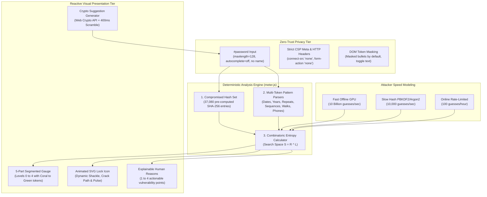

# Password Crack Meter: Cryptographic Strength Engine and Privacy-First Password Analyzer

> **Live Application:** [password-check-iota.vercel.app](https://password-check-iota.vercel.app/)  
> **In-Browser Test Suite (14 Checks):** [password-check-iota.vercel.app/?test=1](https://password-check-iota.vercel.app/?test=1)  
> **Author:** [B Pradeep](https://github.com/Pradeep-B28) | [Portfolio](https://pradeep-b28.github.io/Pradeep-B28/)

---

## Overview

**Password Crack Meter** is a client-side cryptographic password strength analyzer, pattern detection engine, and security education platform created by **Wrench Wise**. Visitors test any candidate password in real time to understand how fast an attacker could crack it, why specific patterns make it vulnerable, and how to construct high-entropy alternatives.

Unlike traditional web password meters that rely on simple character-count heuristics or dispatch keystrokes to remote server APIs, Password Crack Meter runs **100% inside the browser with zero network transmission**. The application operates under a strict Content Security Policy (CSP) with `connect-src 'none'`, ensuring that typed characters never leave the local machine.

Engineered with **zero external libraries, zero bundlers, and zero npm runtime dependencies**, the platform combines an optimized O(1) SHA-256 Bloom/Hash Set containing 37,080 compromised passwords, 8 deterministic pattern extractors, mathematical combinatorics, reactive SVG lock animations, and Web Crypto API password generation.



---

## Technical Specifications and Architecture

| Parameter | Specification |
| :--- | :--- |
| **Dictionary Size** | 37,080 unique pre-computed SHA-256 hashes loaded into a JavaScript `Set` |
| **Lookup Performance** | O(1) constant time hash table lookup (< 0.1ms per keystroke) |
| **Privacy Lock** | CSP `connect-src 'none'`, `form-action 'none'`, zero network transmission |
| **Form Safety** | Zero `<form>` elements; `#password` input lacks a `name` attribute to prevent autofill interception |
| **Memory Sanitization** | Passwords exist purely in-memory; zero storage in `localStorage`, `sessionStorage`, or IndexedDB |
| **Entropy Baseline** | Combinatoric space $S = R^L$ calculated per individual token segment |
| **Attacker Speed Tiers** | Fast Offline (1e10/s), Slow Server Hash (1e4/s), Throttled Online (100/hr) |
| **Dependencies** | Pure Vanilla JavaScript (ES6 modules), native Web Crypto API, CSS custom tokens |
| **Bundle Size** | 0 KB build footprint; native ES module delivery |
| **Performance** | Mobile Lighthouse: 100/100 Performance, 100/100 Accessibility, 100/100 Best Practices |

---

## Strict Privacy Architecture: The Zero-Trust Guarantee

Most password strength checkers introduce severe privacy risks by posting inputs over the network or storing values in browser persistence. Password Crack Meter is architected from the ground up with defensive zero-trust invariants:

| Security Domain | Standard Web Applications | Password Crack Meter Guarantee |
| :--- | :--- | :--- |
| **Network Requests** | Transmits inputs via `fetch()` or `XMLHttpRequest` | **Forbidden by CSP.** `connect-src 'none'` blocks all outgoing HTTP/WS traffic |
| **Form Submissions** | Wrapped in `<form>` tags susceptible to auto-submit | **No `<form>` tag.** Input has no `name` attribute |
| **Keystroke Storage** | Retained in `localStorage` or session caches | **Zero credential storage.** Key stores restricted to theme preferences |
| **DOM Exposure** | Plaintext token strips readable on screen | **Masked by default.** Replaced with bullet glyphs (`•`) until toggled |
| **Social Sharing** | Full password encoded in URLs or query strings | **Zero credential leakage.** Shares time only (e.g., `Cracked in 0.9s`) |
| **Inline Execution** | Inline scripts vulnerable to XSS injection | **CSP `script-src 'self'`.** No `eval()`, zero `innerHTML` / `insertAdjacentHTML` |

---

## How It Analyzes Passwords: The 8 Pattern Detectors

The core engine (`js/engine/meter.js`) decomposes any raw input string into tokenized segments using deterministic, rule-based lexical parsers:

### 1. Hash Set Dictionary Lookup (37,080 Hashes)
- **Role:** Instantly flags the most common passwords compiled from global breach corpora.
- **Data Structure:** JavaScript native `Set` initialized with 37,080 SHA-256 digests.
- **Complexity:** $O(1)$ constant time lookup.
- **Classification:** Level 0 (Very Weak - cracked instantly).

### 2. Calendar Date and Year Recognition
- **Role:** Detects 8-digit full calendar dates (`DDMMYYYY`, `YYYYMMDD`) and standalone 4-digit years (`1900` to `2099`).
- **Parsing:** Validates calendar leap years, month ranges (01-12), and day boundaries (01-31).

### 3. Sequential Runs (Ascending and Descending)
- **Role:** Isolates incremental or decremental character runs across numbers (`123456`, `987654`) and alphabetical runs (`abcdef`, `zyxwvu`).
- **Combinatorics:** Evaluates step differentials: $\Delta = c_{i} - c_{i-1} \in \{-1, +1\}$.

### 4. Keyboard Path Traversal (QWERTY Walks)
- **Role:** Identifies physical spatial walks across standard QWERTY rows (`qwerty`, `asdfgh`, `zxcvbn`).
- **Detection:** Pre-computed adjacency graph linking contiguous horizontal and diagonal key sequences.

### 5. Repetition and Homoglyphs
- **Role:** Detects identical repeating characters (`aaaaaa`, `111111`) that falsely inflate length metrics without entropy.

### 6. Indian and Global Phone Number Formats
- **Role:** Identifies standard 10-digit mobile number patterns starting with regional telecom prefixes (e.g., 6, 7, 8, 9).

### 7. Dictionary Words
- **Role:** Extracts recognizable vocabulary stems, proper nouns, and common names before computing remnant entropy.

### 8. Combinatoric Entropy Calculation
- **Role:** Evaluates remaining unparsed characters using character pool cardinalities:
  $$S = \sum_{\text{token}} |\text{Pool}_{\text{token}}|^{\text{Length}_{\text{token}}}$$
  $$\text{Seconds} = \frac{S}{\text{Attacker Speed}}$$

---

## Attacker Speed Scenarios

The meter recalculates crack time across 3 real-world adversary profiles without altering the underlying cryptographic level:

```
+-------------------+--------------------+-------------------------------------------+
| Attacker Profile  | Guesses / Second   | Real-World Hardware Context               |
+-------------------+--------------------+-------------------------------------------+
| Fast Offline GPU  | 10,000,000,000/sec | High-end 8x RTX 4090 hash cracking cluster|
| Slow Hash         | 10,000/sec         | Modern server-side PBKDF2/Argon2/bcrypt   |
| Online Throttled  | 100/hour           | Web login portal protected by rate limits |
+-------------------+--------------------+-------------------------------------------+
```

---

## Cryptographic Password Generator

Visitors can generate high-entropy replacement passwords using the on-page generator (`js/suggest-ui.js`):

- **Entropy Source:** Cryptographically secure pseudorandom numbers sourced from `window.crypto.getRandomValues()`.
- **Character Composition:** Guaranteed mixture of uppercase, lowercase, numbers (2-9, excluding ambiguous 0 and 1), and security symbols.
- **Micro-Interaction:** 400ms CSS scramble animation where random glyphs resolve left-to-right into the settled recommendation.
- **Clipboard Integration:** Safe `navigator.clipboard.writeText()` with 1.5-second tick feedback without external telemetry.

---

## In-Browser Test Suite (14 Checks)

Password Crack Meter features a comprehensive in-browser test harness accessible via `?test=1`:

| Check ID | Verification Scope | Expected Behavior |
| :--- | :--- | :--- |
| **Check 01** | Empty Input Handling | Returns `empty: true`, Level 0, zero residual tokens |
| **Check 02** | Dictionary Hash Match | `password123` resolves instantly to Level 0 with `common` token |
| **Check 03** | Indian Name and Sequence | `Rahul143` parses into `word` and `random` with 0.9s crack time |
| **Check 04** | Calendar Year Tokenization | `Chennai@2024` parses into `word`, `random`, and `year` tokens |
| **Check 05** | Complex Character Mix | `aB3$xY9!` evaluates to Level 2 (8 days on fast GPU) |
| **Check 06** | Passphrase Length Strength | `correcthorsebatterystaple` evaluates to Level 3 (6 years) |
| **Check 07** | High Entropy Maximum | `Kx7#qLm2vP9$` evaluates to Level 4 (2 million years) |
| **Check 08** | Attacker Speed Invariance | Slow and online speeds adjust duration but keep level invariant |
| **Check 09** | Cryptographic Suggestion | Generates 16-char random string with Level 4 strength |
| **Check 10** | Token String Reconstruction | Token array concatenation exactly reconstructs raw input |
| **Check 11** | Copy Dictionary Values | Interpolates `{time}`, `{program}`, and token definitions |
| **Check 12** | LocalStorage Sandboxing | Key access strictly limited to `pcm-theme` and `pcm-intro-seen` |
| **Check 13** | DOM Safety Rules | Zero inline styles, zero `<form>` tags, no `<script>` text |
| **Check 14** | Content Security Policy | Validates active `connect-src 'none'` CSP protection |

---

## Automated Headless Verification (7,255 Checks)

The repository includes a static analysis and invariant verification harness:

```bash
node tools/verify.mjs
```

**Test Execution Output:**
```
7255 checks passed, 0 failed (21 files scanned)
RESULT: ALL PASS
```

The script verifies:
1. **Locked File Integrity:** SHA-256 hashes of `meter.js`, `common-list.js`, and `vercel.json`.
2. **Deterministic Test Cases:** 18 canonical password benchmark profiles.
3. **Fuzzing and Invariant Stability:** 2,000 pseudo-random Unicode and emoji strings.
4. **Suggestion Uniqueness:** 300 non-repeating cryptographically secure suggestions.
5. **Writing & Privacy Constraints:** Zero forbidden APIs (`fetch`, `XMLHttpRequest`, `sendBeacon`, `innerHTML`, `console.log`).

---

## Local Development Setup

Zero build tools, compilers, or bundlers are required.

1. **Clone the repository:**
   ```bash
   git clone https://github.com/Pradeep-B28/Password_Crack_Meter.git
   cd Password_Crack_Meter
   ```

2. **Start a local static HTTP server:**
   ```bash
   # Using Node npx
   npx serve .

   # Or using Python 3
   python -m http.server 3000
   ```

3. **Open in your web browser:**
   ```
   http://localhost:3000/
   ```

4. **Run the automated verification suite:**
   ```bash
   node tools/verify.mjs
   ```

---

## File Structure

```
Password_Crack_Meter/
  index.html            HTML shell and strict CSP metadata
  config.js             Site URL, sample chips, and feature toggles
  manifest.json         Progressive Web App manifest
  vercel.json           Production edge headers and CSP configuration
  assets/
    icon.svg            Adaptive lock vector favicon
    logo.png            Wrench Wise high-resolution brand asset
  styles/
    tokens.css          Color tokens, typography scale, and elevation
    base.css            CSS reset, container layout, and accessibility
    components.css      Meter cards, input shell, lock icon, and CTA
    motion.css          Lock animations, pulse shaders, and keyframes
  js/
    main.js             Application bootstrapper and module coordinator
    theme-init.js       Zero-FOUC theme initialization script
    store.js            Safe localStorage wrapper with in-memory fallback
    links.js            WhatsApp share link encoder and UTM generators
    motion.js           Scroll reveal observer and card nudge effects
    meter-ui.js         Reactive 5-part gauge, lock SVG, and token strip
    suggest-ui.js       Web Crypto password generator and scramble effect
    sections-ui.js      Hash set stats, pattern cards, and math counter
    selftest.js         In-browser test runner for ?test=1
    copy.js             Text copy dictionary and template interpolator
    engine/
      meter.js          Deterministic entropy and pattern engine
      common-list.js    37,080 pre-computed SHA-256 hash list
  tools/
    verify.mjs          7,255 assertion headless test suite
```

---

## License

This project is open-source under the [MIT License](LICENSE). Built by **Wrench Wise** to demonstrate real-world cybersecurity, cryptography, and Data Structures and Algorithms engineering.
